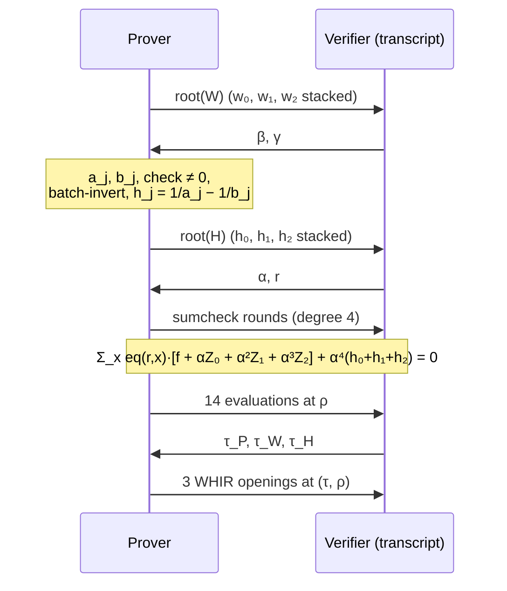

# LogUp: copy constraints and lookups with sums of fractions

*A companion to [`OVERVIEW.md`](OVERVIEW.md) §5.3: what LogUp is, why it works, and how `backend/hyperplonk` uses it to enforce copy constraints inside a single sumcheck.*

Written 2026-11-05. Status: design document, nothing implemented yet. The normative text is [`SPEC-PIOP.md`](SPEC-PIOP.md) §2.1; this document explains it and never overrides it.

**Audience.** A master student who has read OVERVIEW §3 (multilinear extensions, sumcheck, zerocheck) and §5.1 (the circuit table and σ). No knowledge of lookup arguments is assumed.

**How to use the toy examples.** All numbers are in F₉₇ (and once in F₅) and are recomputed by [`toy/logup_examples.py`](toy/logup_examples.py) (`python3 -I docs/hyperplonk-whir/toy/logup_examples.py`, standard library only). The running example is the circuit x² + x + 5 = out from OVERVIEW §5.1.

> [!NOTE]
> **About the boxes**
>
> As in OVERVIEW, blue **Note** boxes answer "why …?" questions and green **Tip** boxes answer "what happens if …?" questions. They can be skipped on a first read.

---

## Contents

1. [The problem: proving that cells are equal](#1-the-problem-proving-that-cells-are-equal)
2. [The classical answer: a grand product](#2-the-classical-answer-a-grand-product)
3. [The logarithmic derivative](#3-the-logarithmic-derivative)
4. [From an identity to a probabilistic test](#4-from-an-identity-to-a-probabilistic-test)
5. [Compressing pairs: the challenge β](#5-compressing-pairs-the-challenge-β)
6. [Copy constraints as a multiset equality](#6-copy-constraints-as-a-multiset-equality)
7. [The general case: lookups with multiplicities](#7-the-general-case-lookups-with-multiplicities)
8. [Making it sumcheck-friendly: helper columns](#8-making-it-sumcheck-friendly-helper-columns)
9. [The full protocol in hyperplonk](#9-the-full-protocol-in-hyperplonk)
10. [The running example, end to end](#10-the-running-example-end-to-end)
11. [Soundness accounting and edge cases](#11-soundness-accounting-and-edge-cases)
12. [LogUp and zero knowledge](#12-logup-and-zero-knowledge)
13. [Design space: helpers, degree and LogUp-GKR](#13-design-space-helpers-degree-and-logup-gkr)
14. [Implementation notes](#14-implementation-notes)
15. [Questions to test your understanding](#15-questions-to-test-your-understanding)
16. [References](#16-references)

---

## 1. The problem: proving that cells are equal

A PLONK-style circuit is a table. Each row is one gate, q_L·a + q_R·b + q_O·c + q_M·a·b + q_C = 0, and the gate check (OVERVIEW §5.2) proves that *every row on its own* is satisfied. That is not enough. A circuit is a graph: the output of one gate is the input of another, and the same variable appears in several cells. The table must also satisfy **copy constraints**: "cell (column j, row i) holds the same value as cell (column j′, row i′)".

In the running example x² + x + 5 = out, the variable x appears in three cells: (w₀, row 1), (w₁, row 1) and (w₁, row 2). Without copy constraints a prover could put 3 in the first two cells and 4 in the third, and adjust v₂ to 13 in row 2 so that every gate still holds (OVERVIEW §5.3 shows exactly this cheater; §10 below). But the table would no longer describe a single evaluation of the circuit.

Copy constraints are encoded by a permutation σ of the 3n cell positions. Each position gets a label id(c) = j·n + i, and σ maps each cell to the *next* cell holding the same variable, so the cells of each variable form one cycle of σ. The copy constraints then read:

  w(c) = w(σ(c)) for every cell c,

that is, "w is invariant under σ". Checking this cell by cell is exactly what the verifier cannot do: it never sees the table. It sees commitments and a handful of evaluations at random points.

LogUp turns "w is invariant under σ" into **one sum over the hypercube that must equal zero**, which is precisely the kind of statement the sumcheck protocol proves.

> [!NOTE]
> **Why can't the zerocheck handle copy constraints directly, like the gates?**
>
> The zerocheck proves "this polynomial expression is zero on every row", where the expression combines values *of the same row*. A copy constraint relates two arbitrary rows, i and σ(i). On the hypercube there is no cheap polynomial map that sends row x to row σ(x): σ is an arbitrary permutation of 3n positions. It can be done (HyperPlonk §3.6 composes with a multilinear σ̃), but at quasi-linear prover cost and with a 2μ-round sumcheck. So copy constraints are usually proved by a *global* argument that compares the whole table with its permuted self.

> [!NOTE]
> **Why is a permutation argument also called a "multiset argument"?**
>
> Because the statement "w is invariant under σ" can be rewritten as an equality of two multisets (§6): the multiset of pairs (value, position) equals the multiset of pairs (value, next position). Lookups ("every value of column f is in table t") are also multiset statements (§7). Every argument in this document is, at heart, a test that two multisets are equal.
>
> *Example.* In the running example, x sits in the cells with labels 1, 5 and 6, and σ cycles them: 1 → 5 → 6 → 1. Each cell c contributes (w(c), id(c)) to the left multiset L and (w(c), σ(c)) to the right multiset R:
>
> | cell c | w(c) honest | L gets | R gets | w(c) cheater | L gets | R gets |
> |---|---|---|---|---|---|---|
> | 1 | 3 | (3, 1) | (3, 5) | 3 | (3, 1) | (3, 5) |
> | 5 | 3 | (3, 5) | (3, 6) | 3 | (3, 5) | (3, 6) |
> | 6 | 3 | (3, 6) | (3, 1) | **4** | **(4, 6)** | **(4, 1)** |
>
> With the honest values, L = R = {(3, 1), (3, 5), (3, 6)}: the same three pairs, listed in a different order. With the cheater's 4 in cell 6, L = {(3, 1), (3, 5), (4, 6)} but R = {(3, 5), (3, 6), (4, 1)}. L has the pairs (3, 1) and (4, 6), and R has (3, 6) and (4, 1) instead, so the two sides differ exactly around the broken copy. σ says which cells belong together, but the check itself never compares two particular cells: comparing the two collections as a whole is enough.
>
> Strictly speaking, with distinct labels every pair occurs at most once, so here L and R are even *sets*. The word "multiset" comes from the general tool. Without labels, or in a lookup, values repeat: f = (2, 5, 2, 2) is the multiset {2, 2, 2, 5}, and how many times 2 occurs matters. That is why the test of §3–§4 is built for multisets.

---

## 2. The classical answer: a grand product

Two multisets A = {a₁, …, a_N} and B = {b₁, …, b_N} of field elements are equal exactly when the polynomials

  P_A(X) = Π_i (X + a_i)  and  P_B(X) = Π_i (X + b_i)

are equal: a polynomial over a field factors uniquely into linear factors, and the multiset of roots −a_i is what P_A records. Two different monic polynomials of degree N differ by a non-zero polynomial of degree ≤ N − 1, so they agree at a random point γ with probability at most (N − 1)/|F| ≤ N/|F| (Schwartz–Zippel), so the verifier picks γ and checks

  Π_i (γ + a_i) = Π_i (γ + b_i),  or equivalently  Π_i (γ + a_i)/(γ + b_i) = 1.

PLONK proves this **grand product** with an accumulator column z: z(1) = 1 and z(ω·X) = z(X)·(γ + a(X))/(γ + b(X)), where ω generates the evaluation domain. The step "go to the next row" is multiplication by ω, which is a cheap substitution in univariate polynomials.

The multilinear world has no ω. The rows of the hypercube are bit strings, and "the next row" is binary increment, which is not a low-degree map. HyperPlonk's paper (§3.3–3.5) therefore proves products with a different construction: an extra polynomial v over μ + 1 variables whose evaluations form a binary tree of partial products, opened at about five points, some of them with boolean coordinates. With a hash-based commitment every extra opening point costs proof size, and the boolean points break the simple masking used for zero knowledge (OVERVIEW §7.2).

LogUp replaces the product by a sum, and sums are what sumcheck proves natively.

> [!NOTE]
> **Why does a product cost more than a sum in the multilinear setting?**
>
> Sumcheck proves statements of the form Σ_x F(x) = S, where F is a low-degree polynomial in the committed columns. A sum over the hypercube is exactly that. A product over the hypercube is not: Π_x F(x) has degree 2^μ in the columns and cannot be written as a low-degree sum. It has to be *unrolled* into intermediate values (the partial products), which are new committed data related by "row x and row 2x, 2x+1" constraints. Those relations are what force the extra variable and the extra opening points.

> [!TIP]
> **What happens if γ is known to the prover before it fixes the table?**
>
> Then it can choose a table whose multiset differs from the honest one but whose product at γ is the same: it only needs one free cell, and it solves the one linear equation "product at γ = target" for that cell. Every argument in this document has this weakness, and every one avoids it the same way: the table is committed first and γ is derived from the transcript afterwards (OVERVIEW §5.6).

---

## 3. The logarithmic derivative

The **logarithmic derivative** of a polynomial P is P′/P. For a product of linear factors the logarithm turns the product into a sum, and differentiation turns each log into a fraction:

  P_A′(X)/P_A(X) = (d/dX) log Π_i (X + a_i) = Σ_i 1/(X + a_i).

(Over a finite field there is no logarithm, but the identity on the right holds formally: apply the product rule to P_A′ and divide.)

So the multiset A is recorded by the rational function Σ_i 1/(X + a_i): a sum of **simple fractions**, one per element, with a pole at each −a_i. Equal multisets give equal sums. The converse is the content of Haböck's Lemma 3 (ePrint 2022/1530):

> **Lemma (logarithmic derivative).** Let F have characteristic p > N, and let (a_i), (b_i) be sequences of N field elements. Then Π_i (X + a_i) = Π_i (X + b_i) if and only if Σ_i 1/(X + a_i) = Σ_i 1/(X + b_i) as rational functions.

*Proof sketch.* "Only if" is the computation above. For "if": group equal elements, so each sum becomes Σ_z m(z)/(X + z) with m(z) the multiplicity of z. Equal rational functions have equal partial-fraction decompositions, which are unique, so m_A(z) = m_B(z) *as field elements* for every z. Multiplicities are integers between 0 and N, and the map {0, …, N} → F is injective when p > N, so the multiplicities are equal as integers, and the multisets coincide.

The rest of LogUp is engineering around this lemma: random evaluation (§4), compression of pairs (§5), helper columns (§8).

> [!NOTE]
> **Why "Up"?**
>
> The original paper is about *lookups* ("multivariate lookups based on logarithmic derivatives"), and the community shortened it to LogUp. Using it for a permutation is the special case where both multisets have the same size and every multiplicity is 1 (§7).

> [!TIP]
> **What happens if the characteristic is not larger than the multiset size?**
>
> The lemma fails, because a multiplicity of p is 0 in the field. Toy in F₅: the multisets {1,1,1,1,1} and {2,2,2,2,2} are different, but 5·1/(γ + 1) = 0 = 5·1/(γ + 2) for every γ where neither denominator vanishes. The products also show it: (X + 1)⁵ = X⁵ + 1 and (X + 2)⁵ = X⁵ + 2 in characteristic 5, and both have derivative 5X⁴ = 0. In bn254, p ≈ 2^253.6 and the multisets have 3n ≤ 3·2^17 elements, so the condition holds with an enormous margin. In a 31-bit field with large tables it is a real constraint, and small-field systems must check it.

**Toy (F₉₇).** A = (2, 3, 3) and B = (3, 2, 3) are the same multiset in a different order. At γ = 5, Σ 1/(γ + a) = 1/7 + 1/8 + 1/8 = 87 and Σ 1/(γ + b) = 87; at γ = 40 both are 49. Order does not matter, only the multiset does.

---

## 4. From an identity to a probabilistic test

The verifier cannot compare two rational functions symbolically. It evaluates both at a random γ ∈ F and compares the two numbers:

  Σ_i 1/(γ + a_i) = Σ_i 1/(γ + b_i).

If the multisets differ, the difference R(γ) = Σ 1/(γ + a_i) − Σ 1/(γ + b_i) is a non-zero rational function. Over the common denominator D(γ) = Π(γ + a_i)·Π(γ + b_i), of degree 2N, it reads R = N_R/D with a numerator N_R that is not the zero polynomial. N_R has degree ≤ 2N − 2: each of the 2N fractions contributes a term of degree 2N − 1 with leading coefficient ±1, and the N positive and N negative ones cancel. A random γ is a root of N_R with probability ≤ (2N − 2)/|F| < 2N/|F|. If γ hits a pole (some γ + a_i = 0 or γ + b_i = 0), the fractions are undefined; in hyperplonk the honest prover then aborts (§11), which happens with probability ≤ 2N/|F|.

**Toy (F₉₇).** A = (1, 2), B = (0, 3). Then

  1/(γ+1) + 1/(γ+2) = (2γ + 3)/((γ+1)(γ+2)),  1/γ + 1/(γ+3) = (2γ + 3)/(γ(γ+3)).

The numerators agree, the denominators differ by γ(γ+3) − (γ+1)(γ+2) = −2, so the two sums agree only where 2γ + 3 = 0, i.e. γ = −3/2 = 47. At γ = 47 both sums are 0; at γ = 5 they are 95 and 27, and the difference is caught. One bad challenge out of 97 (the bound allows up to 2), plus four poles γ ∈ {0, 94, 95, 96}.

> [!NOTE]
> **Why is it fine that the bound grows with N, the size of the table?**
>
> The error is about 2N/|F|. For the permutation in hyperplonk, N = 3n ≤ 3·2^17, so the error is about 2^-234, still a hundred bits below the commitment's 2^-130 (OVERVIEW §8.1). In a 254-bit field a linear-in-n error term is free. In a 64-bit or 31-bit field it would not be, and the challenge γ would have to be drawn from an extension field.

> [!NOTE]
> **Why compare sums of fractions rather than products, if both are tested at one random point?**
>
> At a single point both tests are equally sound; the difference is in how the prover *proves* the evaluated identity. "Σ_i 1/(γ + a_i) − Σ_i 1/(γ + b_i) = 0" is a sum over the table of a function of each row, which sumcheck handles once the fractions are made polynomial (§8). The product version needs an accumulator, which on the hypercube is expensive (§2).

---

## 5. Compressing pairs: the challenge β

The lemma talks about multisets of *field elements*, but the copy-constraint statement (§6) is about multisets of *pairs* (value, position label). LogUp compresses each pair into one field element with a second random challenge β:

  (w, id) ↦ w + β·id.

Two different pairs (w, id) ≠ (w′, id′) collide only if w + β·id = w′ + β·id′, a linear equation in β with at most one solution. More generally, if the multisets of pairs differ, the polynomial Π_c (X + w(c) + Y·id(c)) − Π_c (X + w(c) + Y·σ(c)) in two variables is non-zero, and fixing Y = β makes it vanish identically in X only for at most 3n values of β (look at any non-zero coefficient of a power of X: a polynomial of degree ≤ 3n in Y). So multiset equality of pairs survives compression except with probability ≤ 3n/|F|.

Combining both challenges, each cell c contributes the two field elements

  a(c) = γ + w(c) + β·id(c),  b(c) = γ + w(c) + β·σ(c),

and the test of §4 becomes Σ_c 1/a(c) = Σ_c 1/b(c).

**Toy (F₉₇, β = 11).** The prover controls values, not labels, so a single collision such as 3 + 11·6 = 14 + 11·5 = 69 does not help: changing one cell never makes the compressed multisets equal for β ≠ 0. A whole cycle can be forged, though. If the prover knew β = 11 in advance, it could set the three x-cells (labels 1, 5, 6) to 3, 45, 89 instead of 3, 3, 3. Then the compressed multisets {w(c) + β·id(c)} and {w(c) + β·σ(c)} coincide, and LogUp passes for every γ (only the gate check catches this table, in rows 1 and 2; script §6). Because β is drawn after W is committed, such a table works for at most 3n values of β.

> [!NOTE]
> **Why put β on the label and not on the value?**
>
> Either works algebraically: β·w + id would compress just as well, and both are degree 1 in w. The convention of PLONK (w + β·k·ω^i + γ) and of the HyperPlonk paper is kept so that the formulas match the literature.

> [!TIP]
> **What happens if the labels are omitted, i.e. the test compares {w(c)} with {w(σ(c))}?**
>
> The test becomes vacuous. σ is a bijection, so {w(σ(c))} is just the multiset {w(c)} re-ordered, and every table passes, including the cheater's (the script confirms it). The labels are what tie each value to *where* it sits, so that "the value at position σ(c)" can be compared with "the value at position c".

---

## 6. Copy constraints as a multiset equality

Here is the key claim, in the form used by hyperplonk.

> **Claim.** Let σ be a permutation of the cell positions and labels id(c) distinct. Then w is invariant under σ (w(c) = w(σ(c)) for every c) **if and only if** the multisets
>
>   L = {(w(c), id(c)) : c}  and  R = {(w(c), σ(c)) : c}
>
> are equal.

*Proof.* Re-index R by the label it carries: the pair with label d is (w(σ⁻¹(d)), d). In L the pair with label d is (w(d), d). Each label occurs exactly once in L and exactly once in R (σ is a bijection, labels are distinct). So L = R if and only if, for every label d, w(d) = w(σ⁻¹(d)). That says w is invariant under σ⁻¹, equivalently under σ, equivalently constant on every cycle of σ. ∎

The proof also shows something useful for intuition. With the honest witness,

  b(c) = γ + w(c) + β·σ(c) = γ + w(σ(c)) + β·σ(c) = a(σ(c)),

so **the column of b-values is literally the column of a-values permuted by σ**. The two sides of the LogUp sum contain the same fractions in a different order, and the sum of differences is zero. A broken copy, w(c) ≠ w(σ(c)), makes the pair (w(c), σ(c)) match no pair of L; after compression, b(c) can coincide with some a only by bad luck in β (§5).

> [!NOTE]
> **Why must the labels be distinct, and why is j·n + i enough?**
>
> The proof uses "each label occurs exactly once on each side". If two cells shared a label, L would no longer say which value sits at which position, and a cheater could swap the values of those two cells. The labels j·n + i for j ∈ {0, 1, 2}, i < n are distinct integers below 3n, and 3n is far below p, so they stay distinct as field elements. They are also a linear function of the row bits, so the verifier evaluates id_j(ρ) = j·n + Σ_k 2^{μ−k}·ρ_k itself, in O(μ), without any commitment.

> [!TIP]
> **What happens if two different variables happen to hold the same value?**
>
> Nothing: the pairs carry their labels, so (3, label 1) and (3, label 9) are different elements of the multiset. Coincidences neither help a cheater nor hurt an honest prover.

> [!TIP]
> **What happens if σ is not a permutation, for example because two cells point to the same successor?**
>
> Then R has one label twice and another not at all, so L ≠ R for every witness and even honest proofs fail. σ is built at Setup from the circuit (shared with plonkfri, `internal/plonkperm`) and committed in P; it is part of the circuit, not something the prover chooses. A Setup bug of this kind shows up as a rejected honest proof in the very first test.

---

## 7. The general case: lookups with multiplicities

The same lemma gives **lookup arguments**: "every value of column f appears in table t". Let m(z) be the number of times table entry z is used. Haböck's Lemma 5 states that, for characteristic p larger than the common length N of both sides (pad the shorter one),

  {f_i} ⊆ {t_k}  ⟺  there exist multiplicities m_k with  Σ_i 1/(X + f_i) = Σ_k m_k/(X + t_k).

The prover commits to m along with f, and the verifier tests the identity at a random γ.

**Toy (F₉₇).** f = (2, 5, 2, 2), table t = (2, 5, 7), multiplicities m = (3, 1, 0). At γ = 5 both sides are 13; at γ = 40 both are 76. If the prover replaces the last 2 by 3, which is not in the table, and commits the natural multiplicities m = (2, 1, 0), the two sides at γ = 5 become 84 and 96. No choice of m committed before γ does better, except with negligible probability.

Copy constraints are the special case where both "columns" have 3n entries and every multiplicity is 1. hyperplonk v1 uses only that case, but the machinery is the same, which is why native lookups are a natural later extension (PLAN §9, out of scope for v1).

> [!NOTE]
> **Why is LogUp attractive for lookups compared with older arguments (Plookup)?**
>
> Plookup proves a lookup with a grand product over a sorted, merged column of size |f| + |t|, so the prover must sort and the argument needs an accumulator. LogUp needs neither: no sorting, only the multiplicities m (which the prover counts in one pass) and a sum of fractions. The multiplicities also make repeated lookups free in the table side: using an entry a thousand times only changes m, not the table.

> [!TIP]
> **What happens if the multiplicities m are not committed before γ?**
>
> Then the prover can pick m after seeing γ to make any f pass: the identity Σ_i 1/(γ + f_i) = Σ_k m_k/(γ + t_k) is one linear equation in the m_k, and it always has solutions. The m must be part of the first commitment, together with f, exactly like the witness W in the permutation case.

---

## 8. Making it sumcheck-friendly: helper columns

We now have a test of the form Σ_c 1/a(c) − Σ_c 1/b(c) = 0. Sumcheck can prove Σ_x F(x) = 0 only for a *polynomial* F in the committed columns, and 1/a is not a polynomial in w. Two facts get in the way:

1. The verifier cannot compute the inverse at the end of the sumcheck. The sumcheck ends with a random point ρ, and the inverse of an MLE is not the MLE of the inverses: 1/ã(ρ) ≠ (MLE of the table 1/a)(ρ).
2. The prover cannot be trusted to supply the inverses without a check.

The solution is to **commit the inverses as new columns** and check them with a polynomial identity. hyperplonk uses one helper column per wire column:

  h_j(x) = 1/a_j(x) − 1/b_j(x),  j = 0, 1, 2,

where a_j(x) = γ + w_j(x) + β·id_j(x) and b_j(x) = γ + w_j(x) + β·σ_j(x) are the values for cell (column j, row x). Two families of constraints replace the fraction sum:

- **Row identity** (h_j is what it claims to be): on every row x of the hypercube,
   Z_j(x) = h_j(x)·a_j(x)·b_j(x) − (b_j(x) − a_j(x)) = 0.
- **Sum identity** (the fractions cancel): Σ_{x ∈ {0,1}^μ} (h₀ + h₁ + h₂)(x) = 0.

The row identities are a zerocheck (OVERVIEW §3.2); the sum identity is a plain sumcheck. Both are polynomial in the committed columns, and both go into the same batched sumcheck (§9).

**Why the row identity pins h.** If a·b ≠ 0, the equation h·a·b = b − a has the single solution h = (b − a)/(a·b) = 1/a − 1/b. Toy: a = 7, b = 12 in F₉₇ gives h = 22, and no other h satisfies 22·7·12 = 12 − 7 there. The degenerate cases are discussed in §11.

> [!NOTE]
> **Why check the sum on the hypercube rather than with eq(r, x) weights?**
>
> The row identities must hold on *every* row, so they are weighted by eq(r, x) — that is what makes the zerocheck sound (OVERVIEW §3.2). The sum identity is different: individual h_j(x) are non-zero, only their total vanishes. Weighting it by eq(r, x) would test h̃(r) = 0, which is false for an honest prover. The batched sumcheck therefore has the LogUp sum *outside* the eq factor (OVERVIEW §5.4).

> [!NOTE]
> **Why is it fine that Z_j uses products of MLEs rather than the MLE of the product?**
>
> Sumcheck works with the polynomial h̃_j·ã_j·b̃_j − (b̃_j − ã_j), where each factor is a multilinear extension of a committed column (or of id). On the hypercube this polynomial equals Z_j(x) row by row, which is all the zerocheck needs. Off the hypercube it is *not* multilinear (degree 3 in each variable), but sumcheck does not care: it only needs low degree per variable, and the verifier can evaluate it at ρ from the opened values h_j(ρ), w_j(ρ), σ_j(ρ) and its own id_j(ρ).

> [!TIP]
> **What happens if the prover commits a wrong h on one row?**
>
> Then Z_j ≠ 0 on that row, the eq-weighted bracket of the sumcheck is a non-zero polynomial on the hypercube, and the zerocheck catches it except with probability ≈ 4μ/|F|, exactly like a violated gate. The two checks split the work: the row identity forces h to be the true fractions; the sum identity then tests whether the true fractions cancel.

> [!TIP]
> **What happens if the prover is honest about h but the copies are broken?**
>
> Every row identity holds, because h is computed correctly from a cheating witness. Only the sum identity fails. In the running example (§10) the cheater's helpers satisfy all twelve row identities, and Σ h = 44 ≠ 0. This is the only check in the whole PIOP that sees a broken copy.

---

## 9. The full protocol in hyperplonk

*Standard mode; the ZK additions are in §12.*

In order (SPEC-PIOP §2–§3):

1. The prover commits to the witness stack W. Its root is absorbed into the transcript.
2. The transcript yields β and γ.
3. The prover computes the 6n values a_j(x), b_j(x), checks that none is zero, inverts them all with one batch inversion, and forms h₀, h₁, h₂. It commits to the stack H.
4. The transcript yields α and the zerocheck point r ∈ F^μ.
5. One sumcheck proves
   Σ_x eq(r, x)·[ f(x) + α Z₀(x) + α² Z₁(x) + α³ Z₂(x) ] + α⁴ (h₀ + h₁ + h₂)(x) = 0,
   where f is the gate polynomial. The degree is 4 (eq·h·a·b), so each round message has four field elements.
6. The sumcheck ends at a random point ρ. The prover sends the 14 evaluations at ρ (5 selectors, 3 σ_j, 3 w_j, 3 h_j). The verifier computes eq(r, ρ), id_j(ρ) and PI(ρ) itself, rebuilds
   a_j(ρ) = γ + w_j(ρ) + β·id_j(ρ), b_j(ρ) = γ + w_j(ρ) + β·σ_j(ρ), Z_j(ρ) = h_j(ρ)·a_j(ρ)·b_j(ρ) − (b_j(ρ) − a_j(ρ)),
   and compares the whole expression with the sumcheck's final claim.
7. After drawing τ_P, τ_W, τ_H, three WHIR openings at (τ, ρ), one per stack, prove that the 14 evaluations are correct (OVERVIEW §5.5).

LogUp therefore costs: one extra commitment (H) and its WHIR opening, two challenges (β, γ), six of the 14 evaluations (σ_j and h_j; σ also takes three of P's eight slots), and one degree-4 term in the sumcheck. The H opening is the largest item, about a third of the proof (SPEC-PIOP §6). It adds **no extra opening point**: everything is evaluated at the same ρ as the gate check.

> [!NOTE]
> **Why must W be committed before β and γ, and H before α and r?**
>
> β and γ must be unpredictable when the witness is fixed (§2, §5). α and r must be unpredictable when h is fixed: otherwise the prover could choose a wrong h that makes the batched sum vanish for the known α and r. Each challenge comes strictly after the commitment it constrains, which is the transcript order of OVERVIEW §5.6.

> [!NOTE]
> **Why one sum Σ(h₀ + h₁ + h₂) and not three separate sums Σ h_j = 0?**
>
> Because the separate sums are not zero for an honest prover. Cycles cross columns: x lives in w₀ and w₁, v₁ in w₂ and w₀. A fraction 1/a in column 0 may be cancelled by a −1/b in column 1. In the running example the column sums are 65, 71 and 58; only their total is 0. The multiset statement is about all 3n cells together.

> [!TIP]
> **What happens if the verifier recomputes a_j(ρ) with id_j instead of σ_j, or swaps a and b?**
>
> Swapping a and b everywhere changes the sign of every h_j and of every Z_j, so honest proofs still pass and soundness is unchanged — a harmless symmetry. Mixing them up on one side only (prover uses one convention, verifier the other) makes Z_j(ρ) disagree and every honest proof fails. This is caught by the first honest end-to-end test, which is why it is a nuisance rather than a vulnerability.

---

## 10. The running example, end to end

The circuit x² + x + 5 = out from OVERVIEW §5.1, in F₉₇, n = 4 rows, μ = 2, x = 3, out = 17:

| row | w₀ (L) | w₁ (R) | w₂ (O) |
|---|---|---|---|
| 0 | 17 (out) | 17 | 17 |
| 1 | 3 (x) | 3 (x) | 9 (v₁) |
| 2 | 9 (v₁) | 3 (x) | 12 (v₂) |
| 3 | 12 (v₂) | 17 (out) | 17 |

Cell labels are id = j·4 + i: column w₀ has labels 0–3, w₁ has 4–7, w₂ has 8–11. The cycles of σ are

  out: 0 → 4 → 8 → 7 → 11 → 0,  x: 1 → 5 → 6 → 1,  v₁: 9 → 2 → 9,  v₂: 10 → 3 → 10,

so, column by column, σ₀ = (4, 5, 9, 10), σ₁ = (8, 6, 1, 11), σ₂ = (7, 2, 3, 0).

**Compression with β = 11, γ = 5.**

| column | a_j = γ + w_j + β·id_j | b_j = γ + w_j + β·σ_j | h_j = 1/a_j − 1/b_j |
|---|---|---|---|
| j = 0 | (22, 19, 36, 50) | (66, 63, 16, 30) | (50, 66, 68, 75) |
| j = 1 | (66, 63, 74, 2) | (13, 74, 19, 46) | (10, 18, 13, 30) |
| j = 2 | (13, 16, 30, 46) | (2, 36, 50, 22) | (63, 29, 22, 41) |

Check one cell by hand: (w₁, row 2) holds x = 3, has label 6 and successor σ = 1. So a = 5 + 3 + 66 = 74 and b = 5 + 3 + 11 = 19 (mod 97), h = 1/74 − 1/19 = 13, and the row identity 13·74·19 − (19 − 74) ≡ 0 holds.

The twelve a-values and the twelve b-values are the **same multiset**: each a appears exactly once among the b's, as §6 predicts (b(c) = a(σ(c))). For instance a at cell 6 is 74, and b at cell 5 is also 74, because σ(5) = 6 and both cells hold x. The row sums of h₀ + h₁ + h₂ are (26, 16, 6, 49), not zero individually, and their total is **0**.

**The cheater.** Keep every gate true but break two copies: use x = 4 in row 2 (cell 6) so that v₂ = 9 + 4 = 13 (cell 10), and still copy v₂ as 12 into row 3 (cell 3):

| row | w₀ | w₁ | w₂ |
|---|---|---|---|
| 2 | 9 | **4** | **13** |

All four gates still hold. The cheater computes its helpers honestly from this table, so all twelve row identities hold too. But now the multisets {a} and {b} differ, and Σ h = **44 ≠ 0**: the sum identity rejects.

How lucky would the cheater need to be? With β = 11 fixed, exactly one γ out of 97 (γ = 61) makes the cheater's sum vanish. In bn254 the corresponding probability is below 2^-234.

> [!TIP]
> **What happens if the cheater breaks only the x-copy and outputs v₂ = 12 in row 2 as before?**
>
> Then row 2 reads 9 + 4 − 12 = 1 ≠ 0, and the *gate* check rejects, not LogUp. To get past the gates the cheater has to propagate its change, and every propagated value creates a new broken copy somewhere. This is question 11 of OVERVIEW §16; change `Wc` in the script and see which check fires.

---

## 11. Soundness accounting and edge cases

The LogUp terms of the soundness budget (OVERVIEW §8.1, n = 2^16):

| Event | Bound | Approx. |
|---|---|---|
| β compresses two different pair multisets to equal multisets | 3n/\|F\| | 2^-236.0 |
| γ is a root of the non-zero fraction difference | 6n/\|F\| | 2^-235.0 |
| together ("LogUp", OVERVIEW §8.1) | 9n/\|F\| | 2^-234.4 |
| a_j = b_j = 0 on a row, h unconstrained there | 3n/\|F\| | 2^-236.0 |

The β and γ terms grow linearly in n, unlike the sumcheck and zerocheck terms, which grow with μ = log n. That makes LogUp the largest algebraic term, but still about 100 bits below the commitment terms.

**Edge case 1: a zero denominator for the honest prover.** If some a_j(x) or b_j(x) is zero, h_j(x) is undefined. For a fixed witness this happens for at most 6n values of γ, so with probability ≤ 6n/|F|. The honest prover then returns an error rather than produce a proof (SPEC-PIOP §2.1). No resampling is needed at this probability.

**Edge case 2: a = b = 0 on the same row.** Then Z_j(x) = h·0·0 − 0 = 0 for *every* h, and h_j(x) is unconstrained: a cheater could put any value there and use it to fix the sum. For a = b on one row we need id_j(x) = σ_j(x), i.e. a **fixed point** of σ (a variable used in exactly one cell), or β = 0 (already counted in the compression term, see the TIP below), and then a = 0 needs γ = −w_j(x) − β·id_j(x). W is committed before γ, so this has probability ≤ 3n/|F|. It is listed separately in the budget and tested explicitly with a forced fixed point (SPEC-PIOP §5, review finding F15).

**Edge case 3: a = 0, b ≠ 0 (or the reverse).** The row identity becomes 0 = b, which no h satisfies. A cheater gains nothing; an honest prover hits edge case 1 and aborts.

> [!TIP]
> **What happens if the prover calls `fr.BatchInvert` without checking for zeros first?**
>
> gnark-crypto's batch inversion silently maps 0 to 0. On a row with a_j = 0, the prover would compute h_j = 0 − 1/b_j, which fails the row identity (left side 0, right side b_j), and the honest proof is rejected with no visible reason. The event has probability ≈ 2^-235, so no random test ever reaches it. SPEC-PIOP §2.1 therefore makes the explicit zero check mandatory and a test forces the case.

> [!NOTE]
> **Why is it acceptable that a cheater might control h on a fixed-point row?**
>
> Because reaching that state already requires γ to hit one of at most 3n bad values, after W is fixed: probability ≈ 2^-236. This is one more negligible term in a budget dominated by 2^-130 commitment terms. The point of listing it is not that it is dangerous, but that the original design note mis-stated it (PLAN §10, finding 15) and a correct proof must account for every event.

> [!TIP]
> **What happens if β = 0?**
>
> Then a(c) = b(c) = γ + w(c) for every cell, all labels are ignored, every h is 0, and every table passes. The probability is 1/|F| and it is part of the 3n/|F| compression term (β = 0 is one of the bad values of β whenever the pair multisets differ). The schedule does not resample β; the event is simply too unlikely to matter.

---

## 12. LogUp and zero knowledge

In ZK mode (OVERVIEW §7.2) the helper columns are masked like the witness:

  h*_j(X) = h_j(X) + c_j^H · X₁(1 − X₁),

with secret random c_j^H stored in the mask slot of the H stack. On the hypercube X₁ ∈ {0,1}, so h*_j = h_j there: every row identity and the sum identity are unchanged. At ρ the opened value h*_j(ρ) is offset by c_j^H·ρ₁(1 − ρ₁) and is uniformly random.

Two consequences are specific to LogUp:

- **Round 1 has degree 7.** The term eq·h*·a*·b* multiplies eq (degree 1 in X₁) by three masked factors, each of degree 2 in X₁ (h* directly, a* and b* through w*). After X₁ is bound, every mask is a constant and the remaining rounds are back to degree 4.
- **The helpers leak without masks.** h_j is a function of the witness; revealing h_j(ρ) unmasked would reveal a random linear combination of the inverses 1/a_j(x) − 1/b_j(x), and hence information about w. Masking h is not optional.

> [!NOTE]
> **Why is LogUp friendlier to zero knowledge than the paper's product check?**
>
> The product check opens its accumulator polynomial at points with boolean coordinates, where the mask X₁(1 − X₁) vanishes; those openings would reveal unmasked partial products of the witness. LogUp evaluates everything at the single random point ρ, where the simple mask works. That was the main reason for choosing LogUp in the design (SPEC-PIOP §2.1, "alternatives considered").

> [!TIP]
> **What happens if the prover masks W but forgets to mask H?**
>
> All proofs still verify, so no honest test notices. But h_j(ρ) is revealed in the clear in every proof, and it is a fixed function of the witness. Zero knowledge has to be tested by its own tests (the rank tests of OVERVIEW §7.4), never inferred from passing verification.

---

## 13. Design space: helpers, degree and LogUp-GKR

**How many fractions per helper column?** There are 6n fractions in total (3n with +, 3n with −). Each helper column can carry any number of them, with a trade-off between the number of committed columns and the sumcheck degree:

| Choice | Helpers | Row identity | Sumcheck degree (with eq) |
|---|---|---|---|
| one helper per fraction, g = 1/a | 6 | g·a − 1 = 0 | 3 |
| **one helper per column, h = 1/a − 1/b (hyperplonk)** | **3** | **h·a·b − (b − a) = 0** | **4** |
| one helper per row, h = Σ_j (1/a_j − 1/b_j) | 1 | h·Π a_j b_j − (5-factor terms) = 0 | 8 |

hyperplonk's choice matches the gate's degree 4, so LogUp does not raise the sumcheck degree at all, and the three helpers fit in one four-slot stack H next to the mask block. Six helpers would need an eight-slot stack; one helper would double the round-message size.

> [!NOTE]
> **Why does the degree matter so much, if sumcheck is linear-time anyway?**
>
> Each round message has d + 1 coefficients (d with the s(1) trick), so the proof grows linearly in d. More importantly the prover evaluates the folded tables at d + 1 points per round, so its time grows roughly linearly in d too. The committed-column count has a different cost: every extra column is more data to encode and hash. The table above is the usual balance point between the two.

**LogUp-GKR** (Papini–Haböck, ePrint 2023/1284) avoids committing to any helper. The prover arranges the 6n fractions as the leaves of a binary tree and adds them pairwise as *fractions*, numerator and denominator separately: p₁/q₁ + p₂/q₂ = (p₁q₂ + p₂q₁)/(q₁q₂). Each layer of the tree is a low-degree function of the layer below, which is exactly the structure the GKR protocol proves layer by layer with one sumcheck per layer. The last layer reduces to claims about w and σ (id is computed by the verifier) at the GKR's own random point, which in general differs from the gate check's ρ. The verifier accepts only if the root numerator is 0 and the root denominator is non-zero (2023/1284 §3.2). How the second evaluation point is handled, whether by extra openings of W and P or by reducing the two points to one, is part of the v2 design and not settled here.

Dropping H removes one of the three openings, about a third of the proof (SPEC-PIOP §6); after paying for the GKR layer messages and the second evaluation point, the net saving is estimated at 20–25 % (SPEC-PIOP §2.1). The cost is one small sumcheck per tree layer, about log₂(6n) of them and, more importantly for us, a harder zero-knowledge treatment: every GKR layer's messages are functions of the witness and need their own masking. That is why hyperplonk v1 keeps committed helpers and LogUp-GKR is postponed to v2 (PLAN §9).

> [!NOTE]
> **Why does adding fractions as pairs (p, q) avoid the inversions?**
>
> Inversion is the only non-polynomial step. Keeping each partial sum as an unreduced pair (numerator, denominator) makes every step a polynomial: (p₁, q₁) ⊕ (p₂, q₂) = (p₁q₂ + p₂q₁, q₁q₂). The prover never divides, and the final check "the sum is zero" becomes "the root numerator is zero", which needs no division either. The denominators do grow, but only as field elements, which have a fixed size.

> [!TIP]
> **What happens if the circuit uses lookups later (native range checks, for example)?**
>
> The table side of a lookup contributes fractions m_k/(γ + t_k) with committed multiplicities (§7). They can be added to the same sum identity, with their own row identities, and batched into the same sumcheck with further powers of α. The PIOP structure does not change: the multiplicities m join W (they must be committed before β, γ), the table t joins P at Setup, and the new helpers join H. This is why choosing LogUp for the permutation is also a step towards lookups.

---

## 14. Implementation notes

These points are for the implementer of M1 (PLAN §6); they are recorded in SPEC-PIOP and repeated here because each is easy to get wrong.

- **Batch inversion.** The 6n denominators are inverted with Montgomery's trick: one field inversion plus about 3 multiplications per element. Zero check first (§11).
- **Indexing.** a_j and b_j are indexed by the same hypercube order as the MLEs: row index i = Σ_k 2^{μ−k} b_k, with X₁ the most significant bit (SPEC-PIOP §0). id_j(i) = j·n + i must use the same order, or honest proofs fail.
- **Labels as field elements.** σ_j(i) is the integer `Permutation[j·n + i]` converted to a field element; id_j is never committed. The verifier evaluates id_j(ρ) = j·n + Σ_k 2^{μ−k}·ρ_k in O(μ).
- **Transcript order.** root(W) → β, γ → root(H) → α, r (SPEC-PIOP §3; in ZK mode the mask sum G is absorbed with root(W), and ρ_g is drawn with α, r). The labels `beta` and `gamma` are distinct, so β and γ are independent.
- **Padding rows.** Their cells point to wire 0's cycle and hold wire 0's value, so they contribute matching fractions on both sides and are harmless (OVERVIEW §5.1).
- **Tests that matter** (SPEC-PIOP §5): a copy-breaking witness that satisfies every gate must be rejected; a forced fixed point with a = b = 0; a forced a = 0 that must make the honest prover abort; a wrong h on one row; mutation of β, γ and root(H) in the transcript.

> [!TIP]
> **What happens if h is computed in the evaluation domain of a different stack layout than W?**
>
> The row identity then compares h at row x with w at another row, so Z_j ≠ 0 on most rows and every honest proof fails. The cure is to compute a_j, b_j and h_j from the same `MultiLin` tables that go into the stacks, and to have a unit test that checks Z_j = 0 on every row and Σ h = 0 before any commitment is made.

---

## 15. Questions to test your understanding

*Hint: most questions can be explored by editing [`toy/logup_examples.py`](toy/logup_examples.py).*

1. Prove the "only if" direction of the logarithmic-derivative lemma using the product rule, and explain where the condition p > N is used in the "if" direction.
2. In F₉₇, find two different multisets of size 2 whose fraction sums agree for *two* different values of γ. Why can no pair of size-2 multisets agree for three? (Hint: the degree of N_R in §4.)
3. Show that with the honest witness b(c) = a(σ(c)) for every cell. Deduce that Σ h = 0 without using the lemma.
4. A cheater changes the value of a single cell c. Which a- and b-values change? Show that the multisets {a} and {b} then differ, whatever the new value, provided β ≠ 0 and c is not a fixed point of σ. Why are both conditions needed? Check it in the script.
5. The script finds that the cheater passes for γ = 61 at β = 11. Find all (β, γ) pairs in F₉₇ for which it passes (count only pairs where no a or b is zero, and treat β = 0 separately). Compare the empirical rate with 9n/|F|.
6. Write the row identity for a helper that carries three fractions, h = 1/a₀ + 1/a₁ + 1/a₂. What is its degree, and what does that do to the sumcheck?
7. Design the extra columns and identities for a lookup of w₀ into a fixed table t of size n. Which columns are committed in W, which in H, and which at Setup?
8. Explain why masking h with X₁(1 − X₁) does not change the sum identity, and why it makes round 1 of the sumcheck degree 7.
9. The verifier computes id_j(ρ) itself but obtains σ_j(ρ) from an opening of P. What would break if the prover committed σ in W instead of Setup committing it in P?

---

## 16. References

- U. Haböck, *Multivariate lookups based on logarithmic derivatives* (LogUp), ePrint 2022/1530 (`resources/2022-1530.pdf`). Lemma 3 (multiset equality), Lemma 5 (set inclusion with multiplicities), §3 (the LogUp protocol over the hypercube), §4 (multivariate Plookup, for comparison).
- S. Papini, U. Haböck, *Improving logarithmic derivative lookups using GKR* (LogUp-GKR), ePrint 2023/1284 (`resources/2023-1284.pdf`).
- B. Chen, B. Bünz, D. Boneh, Z. Zhang, *HyperPlonk*, ePrint 2022/1355 (`resources/2022-1355.pdf`). §3.3–3.5 (product and permutation checks that LogUp replaces), App. A (zero knowledge).
- A. Gabizon, Z. Williamson, O. Ciobotaru, *PLONK*, ePrint 2019/953 (`resources/2019-953.pdf`). §5: the grand-product permutation argument.
- A. Gabizon, Z. Williamson, *plookup*, ePrint 2020/315: the grand-product lookup argument LogUp improves on.
- [`SPEC-PIOP.md`](SPEC-PIOP.md) §2.1 (normative LogUp specification), §3 (transcript), §5 (tests); [`OVERVIEW.md`](OVERVIEW.md) §5.3–5.4, §7.2, §8.1.
