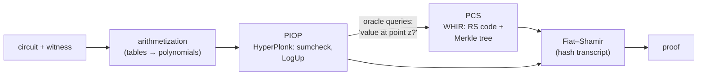
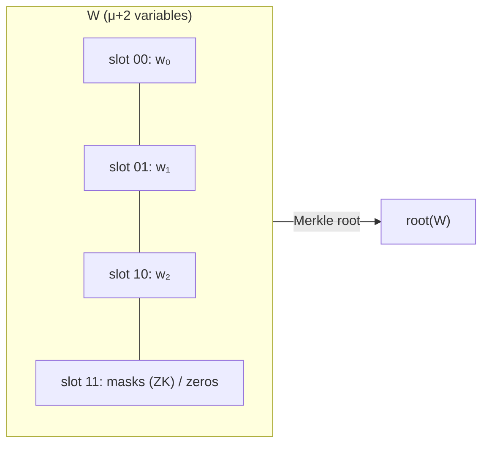
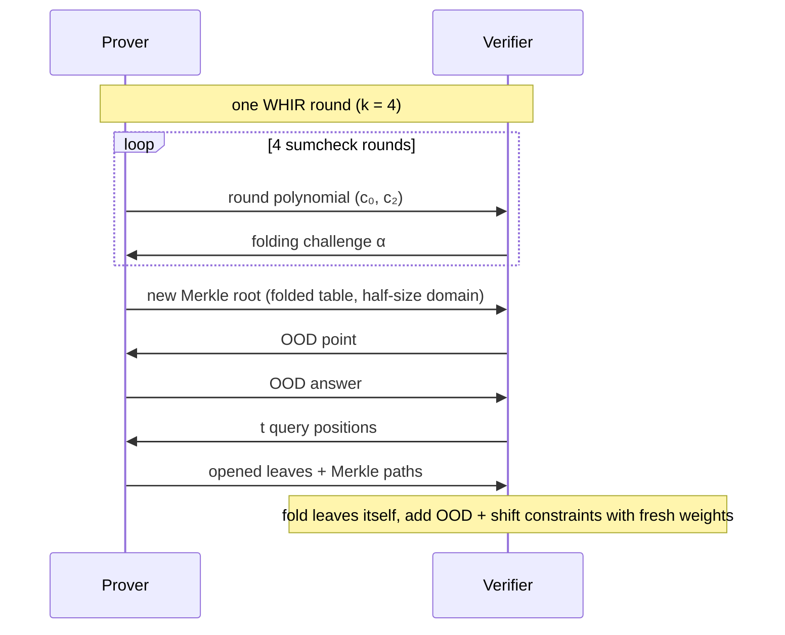

# HyperPlonk with WHIR in gnark: an overview for students

*A self-contained description of the effort: why we are doing it, the cryptography behind it, how it will be built and verified, and where to read more.*

Written 2026-10-27. Status: design approved for review, nothing implemented yet. The normative documents are [`PLAN.md`](PLAN.md), [`SPEC-PIOP.md`](SPEC-PIOP.md), [`SPEC-WHIR.md`](SPEC-WHIR.md) and [`PANURUS.md`](PANURUS.md); this overview explains them and never overrides them. Numbers marked *estimate* have not been measured yet.

**Audience.** A master student who knows finite fields, polynomials, hash functions and basic probability, and has heard of zero-knowledge proofs, but has not worked with SNARK internals. Sections 2 and 3 give the background; skip them if you know it.

**How to use the toy examples.** Every worked example uses tiny fields (F₉₇ for the proof logic, F₁₇ for codes) so you can follow it by hand. All numbers are recomputed by [`toy/toy_examples.py`](toy/toy_examples.py) (`python3 -I docs/hyperplonk-whir/toy/toy_examples.py`, standard library only): change the inputs and watch what breaks. The figures in [`figures/`](figures/) are animated SVGs generated by [`toy/make_figures.py`](toy/make_figures.py) from the same arithmetic; they loop in a browser or on GitHub, follow your light/dark setting, and show their final frame if your system asks for reduced motion.

> [!NOTE]
> **About the "Why …?" boxes**
>
> Boxes like this one answer the questions a careful reader tends to ask at that point ("why not simply …?"). Green **Tip** boxes answer "what happens if …?" questions: what breaks, or what protects us, when an assumption fails, a party cheats or something goes wrong in practice. Both kinds can be skipped on a first read; nothing later depends on them.


---

## Contents

1. [Context and goal](#1-context-and-goal)
2. [Background: SNARKs as PIOP + PCS](#2-background-snarks-as-piop--pcs)
3. [Background: the mathematical tools](#3-background-the-mathematical-tools)
4. [Where we come from: plonkfri](#4-where-we-come-from-plonkfri)
5. [The proof system, part 1: HyperPlonk (the PIOP)](#5-the-proof-system-part-1-hyperplonk-the-piop)
6. [The proof system, part 2: WHIR (the PCS)](#6-the-proof-system-part-2-whir-the-pcs)
7. [Zero knowledge](#7-zero-knowledge)
8. [Security analysis](#8-security-analysis)
9. [Engineering design](#9-engineering-design)
10. [How the work is organised](#10-how-the-work-is-organised)
11. [Integration into Panurus](#11-integration-into-panurus)
12. [Risks and open questions](#12-risks-and-open-questions)
13. [Glossary](#13-glossary)
14. [References (annotated)](#14-references-annotated)
15. [Questions to test your understanding](#15-questions-to-test-your-understanding)

---

## 1. Context and goal

**gnark** (by Consensys) is a Go library for writing circuits and producing zk-SNARK proofs. Upstream it ships Groth16 and PLONK, both based on elliptic-curve pairings. Their polynomial commitment (KZG) needs a **trusted setup** and its security rests on discrete-log-type assumptions that a large quantum computer would break.

This repository is a **fork of gnark v0.16.3** whose goal is *post-quantum polynomial commitment schemes*. The first result is `backend/plonkfri`: PLONK whose commitments are replaced by the hash-based **FRI** protocol. It works and is sound and zero-knowledge by construction (see §4), but its proofs are large: about **0.84–0.90 MB**, compared with ~520 bytes for KZG-PLONK.

**Panurus** (LFDT-Panurus/panurus, a Hyperledger-family token platform) has a privacy-preserving token driver, `zkatsnark`, that proves token transfers with gnark. Pull request [panurus#2539](https://github.com/LFDT-Panurus/panurus/pull/2539) adds `plonkfri` to it as a transparent, plausibly post-quantum option. It works, but each transfer request grows to ~2.5 MiB.

**The goal of this effort** is a second hash-based backend, `backend/hyperplonk`, that is cheaper than plonkfri and can be plugged into Panurus the same way:

- **HyperPlonk** (Chen, Bünz, Boneh, Zhang, ePrint 2022/1355) as the *proof logic*. It is a multilinear version of PLONK built on the sumcheck protocol.
- **WHIR** (Arnon, Chiesa, Fenzi, Yogev, ePrint 2024/1586) as the *commitment scheme*. It is a hash-based multilinear polynomial commitment with very fast verification.
- The **zero-knowledge variant of WHIR** (Chiesa, Fenzi, Weissenberg, ePrint 2026/391), because token amounts and keys are secret.
- Field: the scalar field of **bn254** (a 254-bit prime field), for reasons explained in §4.

Expected outcome (*estimate*): proofs around **0.5 MiB** first, falling towards **0.3–0.4 MiB** after optimisation in non-ZK mode; zero-knowledge adds an estimated 40–80 %, to be measured. Verification takes a few milliseconds. No trusted setup; security rests only on the hash function.

> [!NOTE]
> **Why not keep KZG, or just keep plonkfri?**
>
> KZG gives ~500-byte proofs, but it needs a *trusted setup* (someone must generate secret randomness and destroy it) and its security relies on discrete logarithms in pairing groups, which Shor's algorithm breaks. plonkfri removes both problems but its proofs are ~0.9 MB. The question this effort answers is whether a different proof logic (HyperPlonk) plus a newer hash-based commitment (WHIR) can keep plonkfri's properties at a substantially lower cost.


---

## 2. Background: SNARKs as PIOP + PCS




### 2.1 What a SNARK proves

A *circuit* is a system of polynomial equations over a finite field F. A *statement* is "I know a secret assignment (the **witness**) that, together with these **public inputs**, satisfies every equation". A **SNARK** (Succinct Non-interactive ARgument of Knowledge) is a short proof of such a statement that is much faster to verify than re-running the circuit. **zk-SNARK** adds *zero knowledge*: the proof reveals nothing about the witness beyond the statement being true.

> [!NOTE]
> **Why "argument" and not "proof"?**
>
> In complexity theory a *proof* is sound against provers with unlimited computing power. Our soundness holds only against provers who cannot find hash collisions or invert the random oracle — computationally bounded provers. Such systems are called *arguments*. In practice the distinction is about what is assumed, not about how convincing the result is: with a 256-bit hash, breaking it is far beyond any realistic budget.


### 2.2 The modern recipe: PIOP + PCS + Fiat–Shamir

Almost every modern SNARK is assembled from three parts.

1. **A polynomial interactive oracle proof (PIOP).** The prover encodes the witness as polynomials and sends *oracles* for them: the verifier may later ask for the value at any point. The verifier sends random challenges and finally checks a few polynomial identities at random points. Soundness comes from the **Schwartz–Zippel lemma**: two different polynomials of degree d agree at a random point of F with probability at most d/|F|. In a 254-bit field that is negligible.
2. **A polynomial commitment scheme (PCS).** It makes "oracles" real. The prover *commits* to a polynomial with a short string, and later *opens* it: it proves that the committed polynomial has value v at point z.
   - KZG does this with pairings.
   - FRI and WHIR do it with **Reed–Solomon codes and Merkle trees**, so they need only a hash function.
3. **Fiat–Shamir.** Replace each verifier challenge by a hash of everything sent so far (the *transcript*). The interactive protocol becomes a single message, the proof. Security is argued in the **random-oracle model (ROM)**: the hash is treated as a truly random function.
   - The protocol must be *round-by-round sound*: the cheating chance in each round is small on its own, not only in total.
   - The transcript must bind **everything**: the verifying key, the public inputs and every prover message. Leaving something out gives the "weak Fiat–Shamir" attacks of Dao–Miller–Wright–Grubbs (ePrint 2023/691).

The PIOP decides *what* is proven. The PCS decides *how much it costs* and *what it is secure against*. This project changes both relative to plonkfri: HyperPlonk replaces PLONK as the PIOP, and WHIR replaces FRI as the PCS.

> [!NOTE]
> **Why split a SNARK into a PIOP and a PCS at all?**
>
> Because the two parts can be designed, analysed and swapped independently. The PIOP is pure algebra and is sound against *any* prover in an idealised model where polynomials are perfect oracles; the PCS is the only place cryptography enters. That is exactly what this project exploits: plonkfri and hyperplonk share the hash-based security story, and inside this effort the PIOP is developed against an insecure *mock* PCS while the real WHIR is written in parallel.


**Toy Fiat–Shamir.** In the interactive sumcheck of §3.2 the verifier picks r₁ = 5. Non-interactively the prover computes r₁ itself as r₁ = H(transcript so far) mod p, where the transcript starts with the statement (here "S = 4", and in the real system the verifying-key digest and public inputs) and the first message s₁. A cheater who wants a lucky r₁ (one where its lie happens to survive, §3.2) must try different messages and re-hash; with 2^128 hash evaluations and a 2^-130 chance per try, it fails. If the statement were *not* hashed in, the cheater could pick the statement *after* seeing r₁ — that is exactly the weak Fiat–Shamir attack.

> [!NOTE]
> **Why is it fine that the prover computes the verifier's challenges itself?**
>
> Because it cannot *choose* them. Each challenge is the hash of everything sent so far, so changing a challenge means changing an earlier message and re-hashing — and a random oracle gives a fresh, unpredictable value every time. The only strategy left is trial and error, which is why every round must already have tiny cheating probability on its own ("round-by-round soundness"): an attacker gets as many tries as it can afford hash evaluations.

> [!TIP]
> **What happens if the public inputs are not hashed into the transcript?**
>
> The prover can compute all challenges first and only then choose public inputs that make its (otherwise invalid) proof pass — the public inputs become a free variable it solves for. Dao, Miller, Wright and Grubbs found exactly this in deployed PLONK and Bulletproofs implementations. That is why the schedule absorbs the verifying-key digest and the public inputs before anything else.


### 2.3 Why hash-based means "plausibly post-quantum"

A hash-based PCS needs only collision resistance and the random-oracle model. No efficient quantum algorithm is known that breaks these. Grover-type search does give a square-root speed-up on Fiat–Shamir, so 128 classical bits become roughly 64 "quantum bits". Chiesa–Manohar–Spooner (ePrint 2019/834) analyse this in the quantum random-oracle model.

The project's stated target, the industry norm used by ethSTARK, Plonky2 and RedShift, is **128-bit classical security, plausibly post-quantum**. It is not a proven post-quantum level; see `PROJECT.md`, section "Post-quantum target".

> [!NOTE]
> **Why only "plausibly" post-quantum?**
>
> There is no known quantum attack on hash-based SNARKs beyond generic speed-ups, but *proofs* of security against quantum adversaries (in the quantum random-oracle model) lose a lot: roughly the square root of the classical bound for the protocol part, and a cube-root bound for SHA-256 collisions. With our parameters that gives about 64 provable "quantum bits", not 128. Claiming 128-bit post-quantum security would need roughly twice the queries and a longer hash; the project has chosen not to pay that for v1.

> [!TIP]
> **What happens if a large quantum computer appears?**
>
> KZG-based proofs could then be forged: Shor's algorithm recovers the trapdoor behind KZG's pairing-based commitments, so a prover could "open" a commitment to any value. Hash-based proofs have no such trapdoor. The known quantum speed-up is Grover-type search, which roughly halves the security bits of the Fiat–Shamir part; the parameters (queries, hash length) would be raised, not the design replaced.


---

## 3. Background: the mathematical tools

### 3.1 Univariate vs multilinear

PLONK, and therefore plonkfri, writes each column of the circuit table (n rows) as a **univariate** polynomial of degree < n, interpolated over a multiplicative subgroup H of size n. The checks then need the vanishing polynomial Z_H(X) = Xⁿ − 1, quotient polynomials, and FFTs of size about 4n–16n.

HyperPlonk instead indexes the n = 2^μ rows by **bit strings** x ∈ {0,1}^μ, the *boolean hypercube* B_μ. Each column becomes the unique **multilinear** polynomial (degree ≤ 1 in each variable) that agrees with the column on B_μ: its **multilinear extension (MLE)**.

For a table T, the MLE is

  T̃(X) = Σ_{b ∈ {0,1}^μ} T[b] · eq(b, X),  eq(b, X) = Π_k (b_k X_k + (1 − b_k)(1 − X_k)).

The function eq(b, ·) is 1 at b and 0 at every other point of the hypercube; it is the multilinear "indicator" of b. In code, gnark-crypto's `polynomial.MultiLin` stores T̃ simply as the table of its 2^μ values. Here the first variable X₁ is the **most significant bit** of the row index. This bit-order convention matters everywhere; getting it wrong is a classic bug.

> [!NOTE]
> **Why is the multilinear extension unique, and why does that matter?**
>
> A multilinear polynomial in μ variables has exactly 2^μ coefficients, and its 2^μ values on the hypercube determine them (the eq-formula above is the inversion). So "commit to the table" and "commit to the polynomial" are the same thing, and two different tables give two different polynomials of total degree ≤ μ — which, by Schwartz–Zippel, disagree at a random point except with probability ≤ μ/|F|. Every check in HyperPlonk reduces to that fact.


**Toy example (F₉₇, μ = 2).** Take the table T = (3, 1, 4, 1) on rows 00, 01, 10, 11. Its MLE is

  T̃(X₁, X₂) = 3(1−X₁)(1−X₂) + 1·(1−X₁)X₂ + 4·X₁(1−X₂) + 1·X₁X₂.

At a corner it returns the table entry (T̃(0,1) = 1). At a point *outside* the hypercube, say (2, 3), you could expand the formula, but it is faster to **fold**: fix X₁ = 2 by mixing the X₁ = 0 half with the X₁ = 1 half, (1−2)·(3, 1) + 2·(4, 1) = (5, 1), then fix X₂ = 3: (1−3)·5 + 3·1 = −7 ≡ 90. Each fold halves the table, so evaluating costs O(2^μ). The figure animates this.

> [!NOTE]
> **Why does folding compute the MLE?**
>
> Because the MLE is linear in X₁: T̃(r, X₂, …) = (1 − r)·T̃(0, X₂, …) + r·T̃(1, X₂, …). The two halves of the table are exactly the tables of T̃(0, ·) and T̃(1, ·), so mixing them with weights (1 − r, r) gives the table of T̃(r, ·). Repeating for each variable leaves a single number, the value at the chosen point.


<p align="center"></p>

Why multilinear? The main tool for checking "this holds on every row", the **sumcheck protocol**, needs no FFTs and no quotient polynomials. The prover runs in time linear in n, and high-degree gates are cheap. That is HyperPlonk's selling point.

> [!NOTE]
> **Why the hypercube {0,1}^μ and not a multiplicative subgroup, as in PLONK?**
>
> PLONK needs a subgroup H so that "zero on every row" becomes "divisible by Xⁿ − 1", which requires computing a quotient polynomial with FFTs on a domain several times larger than n. On the hypercube, "zero on every row" is checked by a sumcheck, which only ever *folds* tables in half: O(n) field operations, no FFT, no quotient, and the degree of the gate only affects the size of the round messages. The price is that we need a commitment scheme for *multilinear* polynomials — which is exactly what WHIR is.


### 3.2 The sumcheck protocol (Lund–Fortnow–Karloff–Nisan, 1992)

**Goal.** Prove S = Σ_{x∈{0,1}^μ} F(x) for a polynomial F of degree ≤ d in each variable, while the verifier evaluates F only once.

**Round i**, for i = 1..μ:
1. The prover sends the univariate polynomial s_i(t) = Σ over the remaining boolean variables of F(r_1,…,r_{i−1}, t, x_{i+1},…,x_μ).
2. The verifier checks s_i(0) + s_i(1) = current claim.
3. The verifier picks a random r_i ∈ F and sets the claim to s_i(r_i).

**End.** The verifier checks F(r_1,…,r_μ) = final claim, using a single evaluation of F. In our setting that evaluation comes from PCS openings.

> [!NOTE]
> **Why not let the verifier compute the sum directly?**
>
> The sum has 2^μ terms — 65 536 at μ = 16, millions for larger circuits — and the verifier does not even have the witness. Sumcheck replaces "add up 2^μ values" by μ short messages plus *one* evaluation of F at a random point, and that single evaluation is exactly what a polynomial commitment can deliver cheaply.


**Soundness.** A false claim survives round i with probability ≤ d/|F| (Schwartz–Zippel on s_i), so the total error is ≤ μd/|F|.

> [!NOTE]
> **Why does checking s_i(0) + s_i(1) catch anything — the prover chose s_i?**
>
> The check alone catches nothing; what catches a lie is that the prover must commit to s_i *before* seeing r_i. If the claim is false, any s_i that passes the check differs from the true polynomial, and two different degree-d polynomials agree on at most d points. So with probability ≥ 1 − d/|F| the new claim s_i(r_i) is again false, and the lie is pushed into the next round — until the last round, where the verifier compares against an actual evaluation of F and the lie can no longer hide.

> [!TIP]
> **What happens if the verifier's challenge r_i is predictable?**
>
> Then the cheater picks its round polynomial s_i' to agree with the true one exactly at r_i (any line through the right point will do), the new claim becomes true again, and the lie disappears with probability 1. Unpredictability of every challenge, *after* the message it constrains, is the whole soundness argument — which is why Fiat–Shamir must hash each message before deriving its challenge.


**Tiny example.** Let F(x₁,x₂) = x₁ + 2x₁x₂ over F_p, so S = F(0,0)+F(0,1)+F(1,0)+F(1,1) = 0+0+1+3 = 4.
- Round 1: s₁(t) = F(t,0) + F(t,1) = t + 3t = 4t. Check s₁(0) + s₁(1) = 0 + 4 = 4 ✓. The verifier picks r₁ = 5; the claim becomes 20.
- Round 2: s₂(t) = F(5,t) = 5 + 10t. Check s₂(0) + s₂(1) = 5 + 15 = 20 ✓. The verifier picks r₂ = 7; the claim becomes 75.
- End: the verifier evaluates F(5,7) = 5 + 70 = 75 ✓.

**The same example with a lie.** Suppose the prover claims S = 5. Round 1 must satisfy s₁'(0) + s₁'(1) = 5, so s₁' ≠ s₁ (two different lines). The best the cheater can do is a line that agrees with the true s₁(t) = 4t at as many points as possible, e.g. s₁'(t) = 5t, which agrees only at t = 0. With r₁ = 5 the new claim is s₁'(5) = 25, but the truth is s₁(5) = 20: the lie has been pushed into round 2. Round 2 again needs a wrong line, s₂'(t) = (5 + 10t) + 5t, which agrees with the true s₂ only at t = 0. With r₂ = 7 the final check compares s₂'(7) = 13 with F(5, 7) = 75 and **rejects**. The cheater survives only if r₁ or r₂ lands on an agreement point: probability ≤ 2/97 here, ≤ μ·d/|F| ≈ 2^-248 in bn254.

> [!TIP]
> **What happens if the field is small, say 31 bits?**
>
> Each sumcheck round would leave a cheater a d/|F| ≈ 4/2^31 = 2^-29 chance, and every other algebraic check would be similarly weak — useless for 128-bit security. Small-field systems therefore draw their challenges from an *extension field* (e.g. degree 4 over a 31-bit field ≈ 124 bits). In bn254's 254-bit field one draw is enough, which is part of why this project keeps it.


**Sumcheck as folding.** For a multilinear table the prover's work is exactly the folding of §3.1: in each round it sends the sums of the two halves, s(0) and s(1), then both sides fold at the verifier's r. The animation runs a 3-variable example to the end.

> [!NOTE]
> **Why is the prover linear-time?**
>
> Round i works on a table of 2^{μ−i+1} entries and halves it, so the total work is n + n/2 + n/4 + … < 2n field operations per table. For products of several tables (degree d) each round evaluates the folded tables at d + 1 points, which multiplies the work by a small constant but keeps it O(n) — no n·log n FFT anywhere in the PIOP.


<p align="center"></p>

**Zerocheck.** To prove that a polynomial f vanishes on *every* row, prove Σ_x eq(r, x)·f(x) = 0 for a random r. The sum is f̃'s MLE evaluated at r, and it is 0 for all r only if f is zero on the whole hypercube.

*Why not just Σ_x f(x) = 0?* Take f = (1, −1, 0, 0) on {0,1}²: the plain sum is 0 although f ≠ 0. With the random weights eq(r, x), r = (3, 10) in F₉₇, the weighted sum is 38 ≠ 0 and the cheat is caught. In general a non-zero f has a non-zero MLE, which vanishes at a random r only with probability ≤ μ/|F|.

> [!NOTE]
> **Why must r be drawn from the whole field, not from the hypercube?**
>
> If r were a boolean point, eq(r, x) would be 1 at the single row x = r and 0 elsewhere, so the zerocheck would only test one row — a cheater with one bad row would pass with probability 1 − 1/n. Drawing r from all of F makes Σ eq(r,x)·f(x) equal to f̃(r), a random evaluation of a non-zero multilinear polynomial, which is zero only with probability ≤ μ/|F|. plonkfri learned the same lesson the hard way (fix B: its evaluation point was drawn from too small a set).


**Messages.** In code each round message is sent as evaluations s_i(0), s_i(2), …, s_i(d). The verifier derives s_i(1) = claim − s_i(0), which saves one field element per round.

> [!NOTE]
> **Why send evaluations instead of coefficients?**
>
> Either works; it is an encoding choice. Evaluations are what the prover computes naturally (it sums the folded tables at t = 0, 2, …, d) and make the "derive s_i(1)" trick obvious. WHIR's internal sumcheck in the reference implementation sends coefficients (c₀, c₂) instead; v1 keeps both formats as in their sources and unifies them later (PLAN M4).


### 3.3 Reed–Solomon codes, proximity and Merkle trees

A **Reed–Solomon code** RS[F, L, d] is the set of evaluation vectors (f(x))_{x∈L} of all polynomials f of degree < d on an evaluation domain L ⊂ F with |L| > d. Its **rate** is ρ = d/|L|. Two different codewords differ in at least a 1 − ρ fraction of positions. That redundancy is what lets a verifier who reads only a few positions catch a cheater.

> [!NOTE]
> **Why evaluate on a multiplicative subgroup?**
>
> Two reasons. Evaluating a polynomial of degree < d on a subgroup of size 2^k is an FFT, O(d log d) instead of O(d²). And squaring maps a subgroup of order 2N onto the subgroup of order N, which is what lets folding protocols (FRI, WHIR) move from one domain to the next half-size domain without leaving the structure.


**Toy example (F₁₇).** The powers of 2 form a subgroup L = {1, 2, 4, 8, 16, 15, 13, 9} of order 8. Polynomials of degree < 2 evaluated on L form a code of rate ρ = 2/8. The codeword of f(X) = 3 + 2X is (5, 7, 11, 2, 1, 16, 12, 4). Two different lines agree on at most one point, so two codewords differ in ≥ 7 of 8 positions. If a cheater commits a word that differs from every codeword in at least 3 positions, each random spot check misses all of them with probability ≤ 5/8, and t checks all miss with probability (5/8)ᵗ — 15 queries bring that below 2^-10. That is the whole reason hash-based commitments work, and why "number of queries" is the main cost knob.

> [!NOTE]
> **Why encode at all? Why not Merkle-hash the table itself and spot-check it?**
>
> Without redundancy a single wrong entry is invisible: a cheater could change one value that matters and a random spot check would find it only with probability 1/n. An error-correcting code spreads every coefficient over *all* positions, so "almost right" is impossible — a word is either a codeword or far from every codeword. That turns "catch one bad entry" into "catch one of many bad positions", which a few random queries do with overwhelming probability.


<p align="center"></p>

> [!TIP]
> **What happens if query positions are not uniformly random?**
>
> A cheater would corrupt exactly the positions that are queried least often, and each query would catch it with less than the advertised probability. A common cause is reducing a hash modulo a domain size that is not a power of two. Our domains are powers of two and indices are taken by bit-masking the hash, which is exactly uniform; a chi-square test on sampled indices is part of the WHIR test list.


A **hash-based PCS** works in three steps:
1. The prover evaluates the polynomial on L (an FFT), hashes the evaluations into a **Merkle tree**, and sends the root as the commitment.

> [!NOTE]
> **Why a Merkle tree?**
>
> It commits to a very long vector with one 32-byte root, and later opens any single position with a path of log₂(length) hashes, without revealing anything else. Its only assumption is collision resistance of the hash, which is what makes the whole scheme transparent (no setup) and plausibly post-quantum.

> [!TIP]
> **What happens if the prover opens a leaf with a different value than it committed?**
>
> The verifier recomputes the root from the claimed leaf and its path; with a different leaf it gets a different root and rejects. Making both roots match would require a SHA-256 collision. That is the only thing binding the prover to its codeword — if collisions were ever found, the hash (recorded as a `HashID` in the verifying key) would have to be replaced, and all keys regenerated.

2. To show the committed vector is really (close to) a codeword, i.e. a low-degree polynomial, the parties run a **proximity test**.
   - FRI does this by repeated *folding*: halve the degree with a random combination, commit again, repeat.
   - The verifier spot-checks the folds at random positions (the **queries**). Each query costs a Merkle path, which is why queries dominate proof size.
3. Evaluation claims f(z) = v are reduced to proximity tests of a related function. FRI uses the DEEP quotient (f(X) − v)/(X − z); WHIR builds the claim into its own sumcheck.

**Unique decoding vs list decoding.** If the committed vector is within distance δ < (1 − ρ)/2 of a codeword, that codeword is unique: the *unique-decoding* (UD) regime. Up to the **Johnson bound** δ < 1 − √ρ there can be a short *list* of close codewords, at most about 1/(2η√ρ) for slack η. Working in the Johnson regime needs fewer queries per bit of security, but the analysis needs a property called **(mutual) correlated agreement**, and the commitment then pins down a list rather than one polynomial. Both points matter in §8.

> [!NOTE]
> **Why accept a list instead of a unique codeword?**
>
> Because queries are what we pay for, and each query in the Johnson regime is worth more: at rate 1/8 a query gives ≈ 1.43 bits instead of ≈ 0.83 bits, almost halving the number of Merkle paths in round 0. A short list (≈ 80–160 codewords here) costs only a union bound — a few bits taken from protocol terms that have more than 100 bits to spare (§8.2).


---

## 4. Where we come from: plonkfri

The fork's first backend, `backend/plonkfri`, is described in detail in `PROJECT.md`. A short history helps here, because many design rules of this project are lessons learned there.

- **Origin.** gnark once had a FRI-PLONK backend. It was deleted in 2024; we restored it (RedShift, ePrint 2019/1400, is the reference design).
- **Field choice.** FRI's soundness does not depend on the field, so FRI over bn254's scalar field is as transparent and plausibly-PQ as FRI over a small field. It lets us reuse gnark's existing constraint systems, solver and FFTs. This project keeps bn254 for the same reason.

> [!NOTE]
> **Why does nobody worry that bn254 is an elliptic-curve field, which quantum computers break?**
>
> Because the curve is never used. We only use its *scalar field* — a 254-bit prime field — as a place to do arithmetic. Shor's algorithm breaks discrete logarithms on the curve's group, not arithmetic modulo a prime. Production STARKs prefer small fields (31 or 64 bits) for speed, but then need extension fields for soundness; bn254's large field makes all the algebraic error terms negligible for free and lets us reuse gnark's whole toolchain.

- **Security fixes.** The restored code was not sound. Three fixes made it sound and zero-knowledge:
  - **Fix A:** FRI checked 1 query; now 86 queries at rate 1/8, which gives *proven* 128-bit soundness at the Johnson bound. Also, claimed values are now tied to authenticated Merkle leaves.
  - **Fix B:** the evaluation point ζ was drawn from the FRI domain instead of the whole field (measured forgery rate 4.5 %). It is now out-of-domain (DEEP), on a coset domain, with one batched opening and the verifying key bound into Fiat–Shamir.
  - **Fix C:** zero knowledge: enough random blinding coefficients for every revealed point, a randomized quotient split, and a FRI mask polynomial (Haböck–Al Kindi, ePrint 2024/1037).
- **Outcome.** Sound and honest-verifier zero-knowledge by construction, with an attack test for each mechanism; *not externally reviewed*. At 2^16 constraints: 0.90 MB proofs, ~2.1 s proving, ~4 ms verification.
- **Lessons that carry over** (`PROJECT.md`, "Lessons that generalize"):
  - Passing honest tests says nothing about soundness. Every check needs a test that a *cheating* prover is rejected.
  - Bind every value the verifier uses to something it verified.
  - Write the attack test before the fix, predict its success rate, and check that the measurement matches the prediction.
  - Prover and verifier share one function for anything they must agree on.
  - Privacy cannot be tested by sampling; test the structural condition (full rank of the blinding map).
  - Estimate before measuring.

Why move on from plonkfri? Its size comes from opening 16 univariate polynomials (including the FRI mask) committed in 5 Merkle trees, at two points (ζ and ωζ), at large FFT domains, plus FRI's folding chain. HyperPlonk opens fewer polynomials at **one** point, in three trees. WHIR's rounds shrink the domain faster than FRI, so later rounds need far fewer queries.

> [!NOTE]
> **Why not just optimise plonkfri instead?**
>
> Some of plonkfri's cost can be cut (Merkle multiproofs, proof-of-work, fewer trees), and those items are on its own follow-up list. But the structure stays: PLONK needs a quotient polynomial of degree about 3n, opening points at ζ and ωζ, and several committed rounds, all encoded at large FFT domains. HyperPlonk + WHIR changes the structure itself — one opening point, stacked tables, a rate that drops every round — so it is the better place to look for a large factor.


---

## 5. The proof system, part 1: HyperPlonk (the PIOP)

Normative detail: `SPEC-PIOP.md`. Here we explain *what* each step does and *why*.

### 5.1 From a gnark circuit to tables

gnark compiles a circuit written with `scs.NewBuilder` into a **SparseR1CS**. Each constraint has the PLONK form

  q_L·a + q_R·b + q_O·c + q_M·a·b + q_C = 0,

where a, b, c are wire values and the q's are constants (*selectors*). The rows of our table are, in order:
- one placeholder row per public input;
- one row per constraint;
- padding up to n = 2^μ rows.

> [!NOTE]
> **Why pad to a power of two, and why are padding rows harmless?**
>
> The hypercube {0,1}^μ has exactly 2^μ points, so the table must have that many rows. Padding rows have all selectors zero, so their gate reads 0 = 0 whatever the wires hold, and their wire cells point to wire 0, so the permutation stays a bijection. The cost is at most a factor 2 in table size, which is why circuit sizes just above a power of two are worth avoiding.


This is exactly the layout plonkfri uses, so its permutation builder and gnark's solver output (vectors L, R, O) are reused as-is.

> [!NOTE]
> **Why one placeholder row per public input?**
>
> So that public values live *inside* the witness table, at known positions (the first ℓ rows), and are tied to the rest of the circuit by ordinary copy constraints. The verifier then only has to check that those rows contain the public values it knows — which it does through the PI(X) term in §5.2, without any extra opening.

> [!TIP]
> **What happens if a single gate is violated on one row?**
>
> The gate polynomial f is then non-zero at that row, so its multilinear extension is a non-zero polynomial and Σ_x eq(r,x)·f(x) = f̃(r) ≠ 0 except with probability ≤ μ/|F|. The prover is left defending a false sumcheck claim ("= 0"), which fails exactly like the lie in §3.2. One bad row out of millions is caught as reliably as many — that is the point of the random point r.


The columns become multilinear polynomials:
- **selectors** q_L, q_R, q_O, q_M, q_C: fixed by the circuit;
- **witness** w₀, w₁, w₂: the L, R, O values;
- **permutation** σ₀, σ₁, σ₂ and **identity labels** id₀, id₁, id₂.

Every wire position (column j, row i) has a label id_j(i) = j·n + i. σ maps each position to the next position holding the *same variable*. Copy constraints ("these cells hold the same value") are exactly "w is invariant under σ". The identity labels are a linear function the verifier computes itself; they are never committed.

**Running example: x² + x + 5 = out.** The secret is x = 3 and the public output is out = 17 (all arithmetic in F₉₇). gnark would compile it into roughly these rows (n = 4, μ = 2):

| row | q_L | q_R | q_O | q_M | q_C | w₀ (L) | w₁ (R) | w₂ (O) | the row says |
|---|---|---|---|---|---|---|---|---|---|
| 0 | −1 | 0 | 0 | 0 | 0 | 17 (out) | 17 | 17 | −w₀ + pub₀ = 0 (public input) |
| 1 | 0 | 0 | −1 | 1 | 0 | 3 (x) | 3 (x) | 9 (v₁) | x·x − v₁ = 0 |
| 2 | 1 | 1 | −1 | 0 | 0 | 9 (v₁) | 3 (x) | 12 (v₂) | v₁ + x − v₂ = 0 |
| 3 | 1 | −1 | 0 | 0 | 5 | 12 (v₂) | 17 (out) | 17 | v₂ − out + 5 = 0 |

Unused R/O cells hold "wire 0" (the first public variable, here out), following gnark's padding convention, so they join out's copy cycle. The σ-cycles link the cells that must be equal: x lives at (w₀,1), (w₁,1), (w₁,2); v₁ at (w₂,1), (w₀,2); and so on.

> [!NOTE]
> **Why put unused cells into wire 0's cycle instead of leaving them free?**
>
> σ has to be a permutation of *all* 3n cell positions, so every cell must sit in some cycle. Putting the unused ones into wire 0's cycle is the simplest choice, and it is harmless: those cells are multiplied by a zero selector in their own row, so their value never affects a gate — it only has to agree with wire 0, which the honest prover's solver already guarantees.


<p align="center"></p>

### 5.2 The gate check, with public inputs folded in

The gate polynomial is

  f(X) = q_L w₀ + q_R w₁ + q_O w₂ + q_M w₀ w₁ + q_C + PI(X),

with PI(X) = Σ_i pub_i · eq(⟨i⟩, X), the MLE of the public-input column. On a public placeholder row, q_L = −1 and the other selectors are 0, so the row reads −w₀ + pub_i = 0: the public value is forced into the witness.

> [!NOTE]
> **Why does the gate degree matter so little here?**
>
> The gate is degree 3 (q_M·w₀·w₁) and degree 4 after the eq factor. In sumcheck, degree only sets how many numbers each round message has (d + 1). In PLONK, by contrast, a higher-degree gate makes the quotient polynomial longer and forces larger FFT domains. That is why HyperPlonk advertises cheap *high-degree custom gates* — a feature v1 does not use yet, because gnark's SparseR1CS fixes the gate shape.


The verifier can evaluate PI at any point in time O(2^⌈log₂ℓ⌉ + μ), i.e. roughly O(ℓ + μ), where ℓ is the number of public inputs, because the public rows are the first ℓ rows of the hypercube. The HyperPlonk paper checks public inputs differently, with an extra opening at a point with boolean coordinates. We avoid that because it would complicate zero knowledge (§7).

> [!TIP]
> **What happens if the verifier is given a different public input than the prover used?**
>
> Two things break at once. The verifier hashes *its* public inputs into the transcript, so every challenge differs from the prover's and nothing in the proof matches. And even ignoring that, the verifier's PI makes the public row's gate non-zero: in the running example, with out = 18 the verifier evaluates row 0 as −17 + 18 = 1 ≠ 0. A proof is only ever valid for the exact public inputs it was made with — which is what "the proof is bound to the statement" means.

> [!NOTE]
> **Why is it safe to let the verifier compute PI itself?**
>
> PI is built only from public data — the public inputs and the row positions — so the verifier can evaluate its MLE at ρ without any help, and the prover cannot influence it. If the prover put a different value in a public row, the gate on that row (−w₀ + pub) would be non-zero, and the zerocheck catches non-zero rows.


### 5.3 The permutation check: LogUp instead of a grand product

PLONK proves copy constraints with a *grand product* Π (γ + w + β·id)/(γ + w + β·σ) = 1. HyperPlonk's multilinear version (§3.3–3.5 of the paper) needs an extra polynomial over μ + 1 variables that is opened at about five different points, some with boolean coordinates. With a hash-based PCS every opening point costs proof size, and the boolean points break the simple masking used for zero knowledge.

We use the **logarithmic derivative ("LogUp")** technique (Haböck, ePrint 2022/1530) instead. Write a_j = γ + w_j + β·id_j and b_j = γ + w_j + β·σ_j.
- **The idea.** The multisets {(w, id)} and {(w, σ)} are equal exactly when every variable's value is consistent across its copies. With β, each pair is compressed into one field element. With a random γ, equality of the multisets {a} and {b} is equivalent, except with negligible probability, to Σ 1/a = Σ 1/b. A sum of fractions (a *rational function* identity in γ) has low degree in γ, so Schwartz–Zippel applies.

> [!TIP]
> **What happens if two different variables happen to hold the same value?**
>
> Nothing — the honest prover still passes. LogUp compares the multisets of (value, position-label) pairs before and after applying σ, and σ only moves labels *within* a cycle; equal values in different cycles are simply different pairs on both sides. Conversely, a cheater gains nothing from coincidences, because each pair carries its own position label through β.

- **The protocol.**
  1. After committing to W, the prover receives β, γ.
  2. It commits to helper columns h_j = 1/a_j − 1/b_j.
  3. The PIOP then checks:
     - on every row: Z_j = h_j·a_j·b_j − (b_j − a_j) = 0 (h_j is what it claims to be);
     - in total: Σ_rows (h₀ + h₁ + h₂) = 0 (the fractions cancel).
- **Toy check (F₉₇, running example, β = 11, γ = 5).** With the honest witness, Σ 1/a_j = Σ 1/b_j = 24, and the twelve h values (h₀ = (50, 66, 68, 75), h₁ = (10, 18, 13, 30), h₂ = (63, 29, 22, 41)) sum to 0. Now a cheater keeps every *gate* true but breaks the copies: in row 2 it uses x = 4 instead of 3 (so v₂ = 9 + 4 = 13), and in row 3 it copies v₂ as 12 anyway. Every row of the table still satisfies its own equation, but Σ h = 44 ≠ 0 and the LogUp sum check rejects. Only the permutation argument can see this kind of cheat.

> [!NOTE]
> **Why two challenges β and γ, and why must W be committed before them?**
>
> β glues each value to its position label (w + β·id), so "same multiset of (value, position)" becomes "same multiset of field elements"; γ turns multiset equality into an equality of rational functions, which a random evaluation tests. If the prover saw β and γ before fixing W, it could pick witness values that make the sums cancel by accident. Committing W first forces it to play against challenges it cannot predict — the same "commit, then challenge" pattern as in the sumcheck.

- **Benefit.** Everything is now evaluated at one point (§5.5).

> [!NOTE]
> **Why must h be committed — couldn't the verifier compute 1/a itself?**
>
> The verifier never sees the tables, only a few evaluations at random points, and the inverse of a polynomial is not a polynomial: 1/a(ρ) ≠ (MLE of the table 1/a)(ρ). So the prover commits to the table h, and the PIOP checks *on every row* that h is the right value (h·a·b = b − a) and *in total* that the h's sum to zero. Both checks are polynomial, so the sumcheck can handle them.

> [!TIP]
> **What happens if the prover commits a wrong h on just one row?**
>
> Then Z_j = h_j·a_j·b_j − (b_j − a_j) is non-zero on that row, and the zerocheck part of the batched sumcheck catches it like any violated gate. If instead every h is right row by row but the copies are broken (the toy cheater above), the per-row checks pass and the *sum* Σ h is non-zero (44 in the toy). The two checks cover the two ways to cheat.

- **Edge case worth understanding.** If a_j = b_j = 0 on some row, then Z_j = 0 for *any* h, so h is unconstrained there. This can only happen at a fixed point of σ (a wire used once) when γ happens to equal −w − β·id. W is committed before γ is drawn, so the probability is ≤ 3n/|F|, negligible but tested explicitly. The honest prover simply fails if any a_j or b_j is zero, with probability ≤ 6n/|F|.
- **Alternative.** *LogUp-GKR* (Papini–Haböck, ePrint 2023/1284) would avoid committing to h entirely, saving maybe 20–25 % of the proof. It is postponed to a later version because its zero-knowledge treatment is harder.

> [!NOTE]
> **Why does a permutation check look like a lookup argument?**
>
> Both are *multiset* statements: a lookup says "every value in this column appears in that table", a copy constraint says "the multiset of (value, position) pairs equals the multiset of (value, σ(position)) pairs". LogUp was designed for lookups; a permutation is the special case where both sides have the same size and every multiplicity is 1. A welcome consequence: the same machinery will serve native lookups later.


### 5.4 One sumcheck for everything

After committing to H, the verifier sends α and a random point r ∈ F^μ. One sumcheck over the hypercube proves

  Σ_x  eq(r,x)·[ f(x) + α Z₀(x) + α² Z₁(x) + α³ Z₂(x) ] + α⁴ (h₀ + h₁ + h₂)(x) = 0.

- **Zerocheck parts.** The bracket is a zerocheck (§3.2) of the gate and the three LogUp row identities, batched with powers of α.
- **Sum part.** The last term is the LogUp sum. It needs no eq factor, because we want the plain sum.
- **Degree.** The highest-degree terms are eq·q_M·w₀·w₁ and eq·h·a·b, both of degree 4, so each round message has 4 field elements.

> [!NOTE]
> **Why is the LogUp sum term outside the eq(r, x) factor?**
>
> Because it checks a different thing. The bracket must be zero on *every* row (a zerocheck), and eq(r,x) is what turns that into one random evaluation. The LogUp total, in contrast, must only *sum* to zero over all rows; weighting it by eq(r,x) would instead check h̃(r) = 0, which is false for an honest prover. Random powers of α let both kinds of checks share one sumcheck: a false combination survives only if α hits a root of a degree-4 polynomial.


At the end, the sumcheck leaves the verifier with one random point ρ ∈ F^μ and a claimed value of the whole expression there. The prover sends the 14 column values at ρ: 5 selectors, 3 σ's, 3 w's and 3 h's. The verifier then:
1. computes eq(r, ρ), id_j(ρ) and PI(ρ) itself;
2. recomputes the expression;
3. compares it with the final claim.

All that remains is to show that the 14 values are the true evaluations of the committed polynomials.

> [!NOTE]
> **Why does the verifier need openings for the selectors — it knows the circuit?**
>
> It could compute q_L(ρ), …, σ₂(ρ) itself, but each costs O(n) work over the whole circuit table, and a SNARK verifier is supposed to be much faster than the computation it checks. Opening them from the committed table P costs a few milliseconds regardless of n. The root of P sits in the verifying key, so the openings are tied to the right circuit.


### 5.5 From 14 evaluations to three openings: stacking

Rather than one commitment per column, columns are **stacked**: four columns of μ variables form one polynomial of μ + 2 variables, with the two extra variables selecting the column. Three stacks:

| Stack | Content | Variables | When committed |
|---|---|---|---|
| P | q_L, q_R, q_O, q_M, q_C, σ₀, σ₁, σ₂ | μ + 3 | at Setup, root in the verifying key |
| W | w₀, w₁, w₂, mask block | μ + 2 | first prover message |
| H | h₀, h₁, h₂, mask block | μ + 2 | after β, γ |



**Toy stacking (F₉₇).** Four one-variable columns (1, 2), (3, 4), (5, 6), (0, 0) stack into the 8-entry table (1, 2, 3, 4, 5, 6, 0, 0) on three variables; the first two variables select the column. With selector point τ = (3, 8) and column point ρ = 10, the combination Σ_j eq(τ, j)·c_j(ρ) is 19, and so is the stacked polynomial C(3, 8, 10). One opening of C at (τ, ρ) therefore checks a random combination of all four column claims.

All 14 claims concern the same point ρ. For each stack, the verifier draws a random selector point τ and asks for **one** opening: "the linear combination Σ_j eq(τ, j)·column_j(ρ) is y". A random linear combination of claims is true for random τ only if all claims are (Schwartz–Zippel again). So three PCS openings in total, and no extra "batch evaluation" sumcheck.

> [!NOTE]
> **Why not commit every column in its own Merkle tree?**
>
> Because round 0 of each opening costs about 90 Merkle paths, and that cost is per *tree*, almost independent of the tree's size. Fourteen trees would mean fourteen times that; three stacked trees cost three times. And why a *random* τ rather than, say, summing the columns? A fixed combination would let a cheater lie by +1 in one column and −1 in another; random weights make such cancellations succeed only with probability ≈ 2/|F|.


The fourth slot of W and H holds the zero-knowledge masks (§7) and is zero in non-ZK mode. The linear form the PCS checks must give that slot weight 0, or touch it only through specific cells. This point was caught by the first independent review.

> [!NOTE]
> **Why is P committed at setup rather than by the prover?**
>
> P depends only on the circuit, not on any witness. Committing it once at setup makes the verifying key tiny (a root plus parameters), lets every proof reuse it, and — because the root is hashed into every transcript — binds each proof to that exact circuit. A prover committing P itself could simply choose a different circuit.


### 5.6 The Fiat–Shamir schedule

The transcript, a SHA-256 hash chain with labelled challenges, absorbs, in this order:
1. the verifying-key digest (circuit size, public-input count, every WHIR parameter, the hash function's identity, and root(P));
2. the public inputs;
3. root(W) → challenges β, γ;
4. root(H) → α and r;
5. each sumcheck round message → that round's challenge;
6. the 14 evaluations;
7. the τ's;
8. the three WHIR openings.

> [!NOTE]
> **Why does the order of absorption matter?**
>
> Each challenge must be computed *after* every message it is supposed to constrain. If β and γ were derived before root(W) was absorbed, the prover could see them first and choose a witness table that makes the LogUp sums cancel. The schedule is therefore exactly the interactive protocol's message order, and the verifier replays it byte for byte — any drift between prover and verifier shows up as a rejected honest proof.

> [!TIP]
> **What happens if prover and verifier disagree on the schedule because of a bug?**
>
> If the prover absorbs something the verifier does not (or in a different order), challenges differ and honest proofs are rejected — annoying, but caught at once by the honest tests. The dangerous case is the opposite: the *verifier* forgets to absorb a value the prover controls. Honest proofs still pass, but a cheater can now choose that value after seeing the challenges. Only attack tests catch this, which is why the plan includes a mutation sweep that changes every transcript field in turn and requires each change to be rejected.


A single file in the code defines this schedule, used by both prover and verifier (plonkfri lesson (f)). A byte-level grammar is written down before the code (`FS-GRAMMAR.md`, milestone M0a): exact length encodings, domain-separation bytes, how a 512-bit hash output is reduced to a field element to avoid bias, and how query indices are sampled.

> [!NOTE]
> **Why a 512-bit hash output for a 254-bit field element?**
>
> Reducing a 256-bit hash modulo p ≈ 2^253.6 makes small residues noticeably more likely (2^256 ≈ 5.3·p, so some residues have six preimages and others five): a statistical bias of about 4 %, which an attacker hunting for lucky challenges could exploit. Reducing 512 random bits instead leaves a bias of about 2^-258, which is negligible. The existing gnark sumcheck template uses the biased 256-bit reduction, which is why the plan explicitly says not to copy it.


---

## 6. The proof system, part 2: WHIR (the PCS)

Normative detail: `SPEC-WHIR.md`.

### 6.1 What WHIR proves

WHIR is an interactive oracle proof of proximity for *constrained* Reed–Solomon codes. In PCS terms: given a commitment to a multilinear polynomial P in m variables (stored as its table v of 2^m values) and a **linear form** L with claimed value y, prove ⟨v, L⟩ = y.

> [!NOTE]
> **Why is a proof of *proximity* enough for a commitment?**
>
> A cheater may commit a word that is not exactly a codeword. WHIR does not exclude that; it shows the word is *close* to a codeword that satisfies the claimed linear constraint. For soundness that is enough: the security proof "decodes" the close codeword and uses it as the polynomial the prover is bound to, and being close-but-not-equal gains the cheater nothing, because the verifier only ever trusts statements about that decoded polynomial.


An evaluation P(z) is the linear form eq(z, ·). Our stacked claims from §5.5 are linear forms too, which is why WHIR fits HyperPlonk directly. Several forms on the same vector are combined with a random γ into one.

> [!NOTE]
> **Why WHIR, rather than FRI, Basefold or STIR?**
>
> It is multilinear-native (HyperPlonk's polynomials are multilinear, FRI and STIR are univariate), it accepts arbitrary linear forms (so stacked and masked claims need no extra machinery), and it reduces the rate every round, so later rounds need far fewer queries than FRI or Basefold. Its verifier is the fastest of the family. The SoK (ePrint 2026/1367) compares all four in detail.


### 6.2 Encoding: interleaved Reed–Solomon

1. Split the table v into K = 2^k chunks (k is the **folding factor**; we use k = 4).
2. Read each chunk as the coefficients of a univariate polynomial and evaluate it on a smooth domain L₀ of size 2^{m−k}/ρ (a power-of-two multiplicative subgroup of F*, no coset, in natural order).
3. The Merkle leaf at x ∈ L₀ contains all K chunk evaluations at x.

Folding with α ∈ F^k (Σ_b eq(b, α)·chunk_b) gives the encoding of the folded table P(α, ·). The verifier can recompute that from one leaf with 2^k multiplications. This is the "interleaved RS" view of ePrint 2026/391 (Claim 2.9), and what the reference implementation does.

> [!NOTE]
> **Why fold k = 4 variables per round, not 1?**
>
> Each round adds a Merkle tree, an OOD sample and a batch of queries, so fewer rounds mean a smaller proof; but each leaf holds 2^k field elements, so larger k makes every opened leaf bigger. k = 4 (16 elements per leaf) is the value the plan pins for the reference harness and a good balance for 2^14–2^20 rows; the frozen parameter table makes changing it later a matter of adding rows.


**Toy example (F₁₇, m = 2, k = 1).** The table v = (3, 1, 4, 1) splits into chunk₀ = (3, 1) and chunk₁ = (4, 1), i.e. ĉ₀(X) = 3 + X and ĉ₁(X) = 4 + X, encoded on the same L as in §3.3. The leaf at x = 4 is (ĉ₀(4), ĉ₁(4)) = (7, 8). Folding with α = 5 gives (1−5)·7 + 5·8 = 12. The folded table P(5, ·) = (1−5)·(3, 1) + 5·(4, 1) = (8, 1), whose encoding at x = 4 is 8 + 4 = 12 ✓. One opened leaf is enough for the verifier to compute a point of the *next* round's codeword by itself — that is what makes the shift queries in §6.3 cheap.

<p align="center"></p>

bn254's scalar field has 2-adicity 28 (its multiplicative group has a subgroup of order 2^28), so domains are limited to 2^28 points. That is ample, since m − k + log₂(1/ρ) ≤ 28.

> [!NOTE]
> **Why does 2-adicity matter?**
>
> FFTs and the squaring map between domains need subgroups whose order is a power of two, and the largest such subgroup of F* has order 2^(2-adicity). With k = 4 and ρ = 1/8 the round-0 domain has 2^(m−1) points, so tables of up to m = 29 variables fit — far more than the 2^17-row cap (MaxLogSize) the backend accepts.


### 6.3 One WHIR round

We implement WHIR in the structure of 2026/391, which the reference implementation calls **zook** (the reason is in §6.5). Each round:
1. **Sumcheck, k rounds**, on Σ_b v[b]·w[b] = σ, where w is the combined linear form. Each round folds one variable of v and w with a fresh random challenge. Round messages have degree 2.
2. **Code switch.** The prover commits a new codeword: the folded table encoded on a domain half the size. Because the message shrank by 2^k but the domain only by 2, the rate falls by 2^{k−1} = 8 each round (1/8 → 1/64 → 1/512 …). Lower rate means each query catches more cheating, so later rounds need fewer queries (90 → 44 → 29 in our estimates).
3. **Out-of-domain (OOD) sample.** The verifier picks a random point outside the domain and the prover answers the new codeword's value there. With list decoding, this pins the new codeword down to one member of its list (WHIR Lemma 4.24/4.25).

> [!NOTE]
> **Why does one random evaluation pin down a list member?**
>
> The list holds at most L distinct low-degree polynomials (L ≈ 80–160 here). Two of them agree at a random point only with probability ≈ (degree)/|F|, so after the prover answers one random evaluation, at most one list member is consistent with that answer, except with probability ≈ L²·(degree)/|F| — negligible in a 254-bit field. From then on the protocol can reason as if the codeword were unique.

> [!TIP]
> **What happens if the prover answers the OOD sample falsely?**
>
> The answer becomes a linear constraint on the new message, checked in the next round or the base case like every other constraint. A false answer is consistent with no member of the list (except with negligible probability), so the remaining checks fail. The prover cannot simply omit the answer either: its absence is a malformed proof.

4. **Shift queries.** The verifier samples t_i random positions of the *previous* codeword, the prover opens those Merkle leaves, and the verifier folds them itself. The results, and the OOD answer, become new linear constraints added to w, with fresh random weights.

<p align="center"></p>

> [!NOTE]
> **Why are they called *shift* queries?**
>
> They move ("shift") the consistency check from one round to the next. The verifier opens a leaf of the *old* codeword and folds it itself; the result is what the *new* codeword must equal at the corresponding point. That value is not checked by opening the new tree directly — it is added as a linear constraint on the new message, so it is verified later, in the next round or the base case, together with everything else.




**Base case.** Once few variables remain (fewer than 2k), the prover sends the remaining vector. The verifier spot-checks it against the last codeword, a final sumcheck finishes the evaluation, and one last equation ties everything back to the original linear forms.

> [!TIP]
> **What happens if the prover sends a base-case vector of the wrong length?**
>
> The verifier rejects it outright: the length is fixed by the parameter table, never read from the proof. Accepting a longer vector would let a cheater send a "polynomial" of too high degree that fits arbitrary query answers; accepting a shorter one would break the decoding. The WHIR test list includes length ±1 for exactly this reason.

The verifier's work is essentially Σ_i t_i·(one Merkle path + 2^k multiplications), a few milliseconds. That is WHIR's "super-fast verification".

> [!NOTE]
> **Why is verification not O(n)?**
>
> The verifier never reads the tables. It handles a few hundred query positions per opening, each with a Merkle path of about 15–20 hashes and 16 multiplications to fold a leaf, plus O(m) work per linear constraint. Across our three openings that is roughly 500 paths and ten thousand SHA-256 calls — milliseconds, whatever the circuit size.


### 6.4 Parameters

The per-round error bounds come from WHIR Thm 5.2. The number of queries t_i in round i follows the rule

  t_i = ⌈ (λ − z_i) / −log₂(1 − δ_i) ⌉,

where δ_i is the proximity parameter for that round and z_i is optional *proof-of-work* (grinding) bits.

> [!NOTE]
> **Why does proof-of-work buy security?**
>
> Before the queries are drawn, the prover must find a nonce that makes the transcript hash start with z zero bits; the nonce is absorbed, then the query positions are derived. A cheater hoping for lucky query positions must redo this search for every attempt, so each attempt costs 2^z hashes and z fewer bits are needed from queries. For the honest prover z = 16 is about 65 000 hashes — milliseconds — in exchange for several fewer Merkle paths per round.


- **Johnson-bound regime (default, decision D2).**
  - δ = 1 − √ρ − η with η = √ρ/20. At ρ = 1/8 one query gives ≈ 1.43 bits, so round 0 needs about 90 queries for 128 bits.
  - Its soundness proof needs *mutual correlated agreement up to Johnson*. The WHIR paper only conjectured this (Conj. 4.12). It is claimed proven by two Nov-2025 preprints, Bordage–Chiesa–Guan–Manzur (ePrint 2025/2051) and Haböck (ePrint 2025/2110), neither refereed yet.
  - Error constants: the reference code uses a linear-in-n constant built on ePrint 2025/2055 (whose Thm 1.5 proves ordinary correlated agreement; the *mutual* version is outlined there). The fully proven mutual bounds (2025/2051 Thm 9.2, 2025/2110 Thm 2) are quadratic in n and give ≈ 2^-191 — weaker, but in a 254-bit field still far below 2^-130, so only the query terms bind. Our independent checker uses the proven bound.
- **Unique-decoding regime (selectable).** δ = (1 − ρ)/2, proven in the WHIR paper itself, but about 2.5–3× larger proofs.

> [!TIP]
> **What happens if the 2025 Johnson-regime results turn out to be wrong?**
>
> The default parameters would then rest on an unproven bound — not necessarily broken, but no longer justified. The fallback is built in: the unique-decoding regime is selectable and proven in the WHIR paper itself, at about 2.5–3× the proof size. The regime is part of each verifying key's header, so switching means generating new keys with UD headers; no code changes are needed.

- **Up-to-capacity regime: excluded.** Its conjectures, as stated, were shown false in November 2025 (Crites–Stewart, ePrint 2025/2046; 2025/2055 gives counterexamples in characteristic 2). Many published WHIR benchmarks used it, so do not compare our numbers with those.

> [!NOTE]
> **Why exclude a regime when nobody has shown a practical attack?**
>
> Because the parameters would be derived from a bound that is now known to be false. A refuted conjecture may still be "almost true" in practice, but "almost" has no number attached, and a security claim needs one. The Johnson regime rests on results that are proven but not yet refereed — a calculated risk, recorded in the security status, with unique decoding as the fully proven fallback.


Each of our three openings targets λ = 130 bits, so the union of three stays above 128.

> [!NOTE]
> **Why 130 and not 128 per opening?**
>
> A cheater wins if it fools *any* of the three openings, so the error probabilities add: 3·2^-130 ≈ 2^-128.4, just above the target. Asking 128 bits of each would give 3·2^-128 ≈ 2^-126.4, slightly below. The extra two bits cost one or two queries per round.

> [!TIP]
> **What happens if the circuit exceeds 2^17 rows?**
>
> Setup refuses it: `MaxLogSize = 17`, the same cap as plonkfri (Panurus's circuits have about 2^14 rows). The cap is about memory, not security — the prover's encoded copy of P alone is 2^(μ+3)·8 field elements, ≈ 256 MiB at 2^17 rows — and about bounding what a malicious key or proof header can make a decoder allocate. Raising it means extending the parameter table and the decoders' bounds.


**Parameters are a frozen table.** The derivation uses floating-point logarithms. Go may fuse floating-point operations differently on ARM and x86, so two machines could disagree near an integer boundary, and a verifying key made on one would be rejected on another. Instead, an offline generator (a port of the reference code's parameter module) writes a **frozen, versioned table** into the Go source. At run time parameters are only looked up. Every row is re-checked by an independent security checker, and the verifying key's digest hashes the full row.

> [!NOTE]
> **Why rate 1/8, when 1/2 would make the prover's FFTs four times smaller?**
>
> Because queries dominate the proof. At ρ = 1/2 in the Johnson regime one query gives only ≈ 0.43 bits, so round 0 needs about 298 queries instead of 90 — more than three times the Merkle paths. ρ = 1/8 trades a bigger encoding (prover time and memory) for a much smaller proof, the same trade plonkfri made.


*Estimates* (k = 4, ρ = 1/8, Johnson, no Merkle-path compression): one opening at m = 16 ≈ 157 KiB, at m = 20 ≈ 200 KiB. Our openings are at m = μ + 3, μ + 2, μ + 2, giving ≈ 0.48–0.57 MiB per proof at 2^16 rows. Merkle multiproofs, a 16-bit proof-of-work, and opening W and H jointly could bring that to ≈ 0.3–0.4 MiB.

> [!NOTE]
> **Why does the proof barely shrink for smaller circuits?**
>
> The number of round-0 queries depends only on the security level and the rate (≈ 90 for 130 bits at ρ = 1/8), not on the circuit size. A smaller circuit shortens each Merkle path by a few hashes and drops a round, but the dominant cost — about 90 paths per tree — stays. That is why the estimate at 2^14 rows (≈ 0.46–0.49 MiB) is close to the one at 2^16.


### 6.5 Why the "zook" structure, not the original WHIR

The original WHIR protocol, as a PCS, adds an OOD sample when the commitment is made. In zero-knowledge mode that sample reveals P at a point *unmasked*. The ZK construction therefore moves OOD sampling into each code switch, where it can be answered through a **private zero-evader** (§7.3).

If we built original WHIR first and the ZK variant later, the second would be a rewrite: a different message order, different parameters, different proofs. Building the zook structure from the start in its non-ZK mode ("Standard") makes zero knowledge a mode switch. This was the main finding of the first independent review.

> [!NOTE]
> **Why build a non-ZK version first at all, if ZK is mandatory?**
>
> Because ZK adds randomness everywhere, and randomness hides bugs: a non-ZK proof is deterministic, so it can be compared byte for byte with golden files and with the reference implementation's test vectors. Getting soundness right first, then adding masks whose only job is privacy, separates two hard problems — the same order plonkfri followed (fixes A and B for soundness, then fix C for ZK).

> [!TIP]
> **What happens if a deployment accidentally runs in Standard (non-ZK) mode?**
>
> Proofs stay sound — Standard mode is the same protocol without the masks — but they leak information about the witness (round messages, w(ρ), opened codeword rows). The mode is part of the verifying key and its digest, so it cannot be switched silently per proof, and the Panurus integration rejects verifying keys whose mode is Standard (PLAN R13).


One consequence: without commit-time OOD, the initial commitment in the Johnson regime binds the prover only to a *list* of up to about 10/ρ = 80 codewords (up to ≈ 160 when power-of-two rounding lowers the rate). §8.2 explains why that is harmless.

> [!NOTE]
> **Why not add the commit-time OOD sample back in non-ZK mode?**
>
> Then the Standard and ZK modes would be two different protocols, with different message orders, parameter derivations and proofs — exactly the rewrite the zook structure avoids. The price of leaving it out is a union bound over the list, about 6 bits per committed oracle, taken from PIOP terms that have more than 100 bits to spare.


---

## 7. Zero knowledge

A token proof must not leak amounts or keys, so ZK is mandatory before Panurus uses the backend (decision D3). It is added in milestone M3, after a working non-ZK version.

### 7.1 What leaks without it

- the sumcheck round messages, which are sums of the witness;
- the evaluations w_j(ρ) and h_j(ρ);
- WHIR's opened Merkle rows, OOD answers, internal sumcheck messages and final vector.

> [!NOTE]
> **Why would sums leak anything?**
>
> Take a table where every entry is public except one. Its sum — the first sumcheck message, essentially — reveals the secret entry immediately. Real circuits are less extreme, but every round message is a fixed public combination of witness values, and enough such combinations can pin down secrets. Zero knowledge has to hide each revealed number, not only the tables.


### 7.2 Layer 1: masking the PIOP

**Witness masks** (HyperPlonk App. A, Lemma A.1). Replace each witness column w_j by

  w*_j(X) = w_j(X) + c_j · X₁(1 − X₁)

with a secret random c_j. On the hypercube X₁ ∈ {0,1}, so w*_j = w_j and nothing changes for the constraints. At the random point ρ, the value w*_j(ρ) is offset by c_j·ρ₁(1 − ρ₁), which is non-zero except with probability 2/|F|. So w*_j(ρ) is uniformly random. Each column is opened exactly once, so one coefficient is enough. The same applies to h_j.

> [!NOTE]
> **Why X₁(1 − X₁), and why only one random coefficient?**
>
> Any polynomial that vanishes on the whole hypercube would do; X₁(1 − X₁) is the cheapest one — degree 2 in a single variable — and X₁ is the variable the sumcheck binds first, so the mask only changes round 1. One coefficient suffices because each column is revealed at exactly one point ρ: one uniformly random offset makes one revealed value uniform. A column revealed at t points would need t independent coefficients.

> [!TIP]
> **What happens if ρ₁ happens to be 0 or 1?**
>
> Then ρ₁(1 − ρ₁) = 0, the mask vanishes, and w*_j(ρ) is the true w̃_j(ρ) — revealed unmasked. The probability is 2/|F| ≈ 2^-253. The spec deliberately does not resample in this case: soundness is unaffected, and the only consequence is a negligible chance of one proof losing zero knowledge for those values.


**Toy example (F₉₇, running example).** Mask w₀ = (17, 3, 9, 12) with c = 40. On the four rows w*₀ is still (17, 3, 9, 12), so every gate and copy check is unchanged. At ρ = (10, 20) the unmasked value would be w̃₀(ρ) = 50; the verifier instead sees w*₀(ρ) = 39, offset by 40·10·(1−10) ≡ 86. A different random c gives a different value, uniformly: the opened number says nothing about the witness.

<p align="center"></p>

**Libra-style sumcheck mask** (Xie et al., CRYPTO 2019; HyperPlonk App. A.3).
1. The prover picks a random g(x) = g₀ + Σ_i g_i(x_i), a sum of univariate polynomials: degree 7 for g₁, degree 4 for the others. (The constant is called g₀ to avoid confusion with the mask c₀.)
2. It sends G = Σ_x g(x).
3. The verifier sends ρ_g, and the sumcheck runs on F* + ρ_g·g with claim ρ_g·G.

Each round message then contains fresh random coefficients from g, so the messages can be simulated. At the end, g(ρ) is revealed, which the lemma allows.

> [!NOTE]
> **Why mask the sumcheck if the witness columns are already masked?**
>
> The witness masks only help where X₁ ∉ {0,1}. The round messages are *sums over the hypercube* of products of witness values, and in every round after the first those sums no longer involve the mask at all — they are aggregated functions of the real witness. Adding ρ_g·g with fresh random coefficients makes each round message uniformly random apart from the one relation the verifier checks, which is what a simulator needs.

> [!TIP]
> **What happens if the prover reuses its randomness across proofs?**
>
> Zero knowledge assumes fresh, independent masks in every proof. In WHIR's encoding, each codeword carries just enough random coefficients to hide the positions one proof reveals; two proofs of the same witness with the same randomness reveal positions of the *same* codeword, more than its random coefficients can hide, so the randomness — and then the witness — can be solved for. The prover must draw all masks from a cryptographic RNG (crypto/rand) per proof; a deterministic RNG would break zero knowledge, as plonkfri's design notes already record.


**Where the mask coefficients live.** WHIR commitments are not additive: you cannot add a commitment to c to a commitment to w. The coefficients c_j and the Libra coefficients therefore sit **inside** the fourth slot of the W stack (and of H), and the linear form for the opening picks them up cell by cell. A design with a separate fourth commitment for the masks was considered and rejected in the review debate: the opened value of W would then be an unmasked combination of witness values.

> [!NOTE]
> **Why not hide the witness with random padding rows instead?**
>
> Random rows would have to satisfy every gate and copy constraint, and the derived columns (the LogUp helpers h) are computed from the witness, so their padding cannot simply be random. Adding the mask X₁(1 − X₁) changes nothing on the hypercube, so every constraint keeps holding automatically, and the effect on revealed values is easy to analyse.


**Small circuits.** The W mask block needs 4μ + 7 cells. In ZK mode the circuit is therefore padded to at least μ = 5 (32 rows).

> [!NOTE]
> **Why does the mask block need 4μ + 7 cells?**
>
> Three cells hold c₀, c₁, c₂ (one per witness column). The Libra mask g needs one constant, 7 coefficients for g₁ (degree 7, because round 1 has degree 7 under masking) and 4 for each of the other μ − 1 variables: 1 + 7 + 4(μ − 1) = 4μ + 4. Together: 4μ + 7. At μ = 4 that is 23 cells but slot 3 only has 16, hence the floor μ ≥ 5 (27 ≤ 32).


**Prover subtlety.** The masks make the first sumcheck round degree 7, because w* is quadratic in X₁ and the gate multiplies masked columns. They enter non-linearly: q_M·w*₀·w*₁ contains c₀c₁·t²(1−t)². So the prover must add each mask to its column *before* combining columns. The sumcheck package has a dedicated round-1 hook for this. A test compares it with brute-force evaluation on a tiny instance.

> [!NOTE]
> **Why degree 7 exactly?**
>
> In round 1 the variable is X₁. The LogUp term eq·h*·a*·b* multiplies eq (degree 1 in X₁) by three masked factors, each degree 2 in X₁ (h* directly, a* and b* through w*). That is 1 + 2 + 2 + 2 = 7. After X₁ is fixed to ρ₁ the masks become constants, so every later round is back to degree 4.


### 7.3 Layer 2: zero-knowledge WHIR (ePrint 2026/391)

WHIR's own messages are made simulatable by four mechanisms:
- **ZK encoding** (Prop. 3.19): each chunk is encoded with extra random coefficients, at least as many as the positions the verifier will see. Any set of revealed positions then looks uniformly random.
- **ZK sumcheck inside WHIR** (Construction 6.3): small random mask polynomials, committed in a separate small Merkle tree before the sumcheck.
- **ZK code switch** (Construction 9.7): the folded randomness is carried into the next round through a second small "code-switch mask" tree, and OOD answers go through a **private zero-evader** (Def. 9.2), so they are uniform.
- **Mask proximity and a ZK base case** (Construction 7.2): every round proves the mask trees are honest codewords, and the final vector is sent only blinded.

Two deliberate deviations from the reference implementation (pinned at commit `c73b8d3` of github.com/WizardOfMenlo/whir):
1. **Salted Merkle leaves.** The reference does not salt. Without salts, a verifier who guesses a low-entropy witness (say a small token amount) could solve for the encoding randomness from the opened rows, recompute an unopened leaf and compare its hash, confirming the guess. With 32 random bytes per leaf this fails. A dedicated test shows the attack working without salts and failing with them.
2. **Power-of-two domains.** On bn254 the reference sometimes picks non-power-of-two codeword lengths; we round up, because gnark-crypto's FFT and our unbiased index sampling are power-of-two only.

> [!NOTE]
> **Why is honest-verifier zero knowledge enough?**
>
> Zero knowledge against an honest verifier means "a verifier who picks its challenges at random learns nothing". After Fiat–Shamir there is no verifier choosing challenges at all: they are hash outputs, which a malicious verifier cannot influence. So the honest-verifier simulator, combined with programming the random oracle, gives non-interactive zero knowledge in the random-oracle model.

> [!TIP]
> **What happens if the witness has very little entropy, e.g. a token amount between 0 and 100?**
>
> The cryptographic masks still hide it: every revealed value is shifted by fresh uniform randomness, so the proof is distributed the same way for amount 3 as for amount 97. The one place low entropy used to matter is the Merkle leaves — without salts, a verifier could test each of the 101 guesses against unopened leaves' hashes. The salts close that, and a dedicated test shows the guessing attack working without them and failing with them.


**Cost.** Two extra small trees per round, each queried about 90 times. The estimated overhead is +40–80 % of total proof size, to be measured with the reference implementation before the WHIR code is written (gate G0).

> [!NOTE]
> **Why does ZK cost so much more than the PIOP masks suggest?**
>
> The PIOP masks are a few dozen field elements — negligible. WHIR's zero knowledge, in contrast, adds small committed mask trees in every round, and every tree has to be queried as often as the main one to reach the same security level. Queries, not field elements, are what proofs are made of, so each extra tree costs its own ~90 Merkle paths.


### 7.4 How ZK is tested

"The output looks random" cannot be tested by sampling: every 254-bit value looks random (plonkfri lesson (h)). Instead the tests check the structural conditions the proofs rely on. Each is a *linear* map, and each must fail with ZK switched off:

> [!NOTE]
> **Why does a full-rank test prove privacy?**
>
> Each revealed value is the witness's contribution plus a linear function of the prover's secret randomness. If the matrix mapping randomness to revealed values has full rank, every combination of revealed values is shifted by an independent uniform amount, so the revealed tuple is uniformly distributed whatever the witness is — exactly the statement "a simulator can produce it without the witness". A rank deficiency would mean some combination of revealed values depends on the witness alone, i.e. a leak.

- the Libra coefficients map onto the round messages with full rank;
- the c_j map onto the revealed w*_j(ρ), h*_j(ρ) with full rank;
- in each WHIR sub-protocol, the encoding randomness maps onto the opened rows and OOD answers with full rank;
- with ZK off, w_j(ρ) can be recovered from the transcript; with ZK on, the same procedure fails;
- the salt attack of §7.3.

**Revealed-value inventory** (each item and what covers it):

| Revealed | Why it is safe |
|---|---|
| Merkle roots | salted hashes |
| sumcheck messages, G | Libra lemma (A.2) |
| w*, h* at ρ | witness masks (A.1) |
| selectors, σ, PI at ρ; P's opening | public anyway |
| g(ρ) | allowed by the Libra lemma |
| opened values y_W, y_H | linear in already-covered values |
| everything inside the W/H openings | 2026/391 theorems (ROM, salts) |

---

## 8. Security analysis

### 8.1 Soundness budget (n = 2^16)

| Source | Bound | Approx. |
|---|---|---|
| zerocheck point r | 4μ/\|F\| | 2^-247.6 |
| α batching | 4/\|F\| | 2^-251.6 |
| sumcheck (degrees 4, and 7 in ZK round 1) | Σ d_i/\|F\| | 2^-247.5 |
| LogUp (β compression, rational identity in γ) | 9n/\|F\| | 2^-234.4 |
| LogUp a = b = 0 case | 3n/\|F\| | 2^-236.0 |
| Libra ρ_g, stacking τ | 1/\|F\| + 7/\|F\| | ≈ 2^-250.6 |
| **each WHIR opening** | **2^-130 target** | **dominant** |

The PIOP terms sit about 100 bits below the PCS terms: in a 254-bit field the algebra is essentially free, and the hash-based commitment sets the security level. The non-interactive version uses Fiat–Shamir. Every round is round-by-round sound (sumcheck rounds trivially; WHIR/zook by 2026/391 §2.1). An attacker making 2^128 hash queries gains at most about 2^-92 on the PIOP terms, even after the worst-case list loss below.

> [!NOTE]
> **Why is the security level set by the commitment and not by the algebra?**
>
> Every algebraic check fails with probability around (degree × size)/|F|, and |F| ≈ 2^254 makes that about 2^-234 or smaller. The commitment, in contrast, relies on random *queries* into a codeword, and each query only buys one or two bits; reaching 130 bits costs ~90 queries in round 0. So the cost of the whole proof is decided by how many bits we ask of the PCS — which is why every size discussion in this document is about WHIR parameters.


### 8.2 The list-decoding subtlety

In the Johnson regime, a commitment to W (or H) is consistent with up to L ≈ 10/ρ polynomials — 80 at ρ = 1/8, up to ≈ 160 where power-of-two rounding lowers the actual rate. A cheater may effectively pick which one to "mean" after seeing later challenges. A union bound covers this:
- PIOP steps before H is committed lose at most a factor L_W;
- steps after it lose at most L_W·L_H ≤ 160² = 25 600, i.e. about 14.6 bits off 2^-234: harmless.
- With ZK encoding the argument still holds (the list lives in the masked code and projects to at most L messages).

P is exempt for a different reason: an honestly generated P is an exact codeword, and other codewords are too far away to be on its list. That assumes the verifying key is honest. Setup is deterministic, so anyone can regenerate the key from the circuit and compare.

> [!NOTE]
> **Why should a verifier regenerate the verifying key?**
>
> Fiat–Shamir binds every proof to the verifying key it was made for, but it cannot tell whether that key belongs to the *intended* circuit. A malicious key — a different circuit, or a committed P that is not a clean codeword — would make "valid" proofs meaningless. Because setup is transparent and deterministic, anyone holding the circuit can recompute the key and compare bytes; Panurus relies on exactly this for its public parameters.

> [!TIP]
> **What happens if an attacker spends 2^128 hash evaluations on one proof?**
>
> Each try gives it roughly a 2^-130 chance per WHIR opening (and far less against the algebraic checks), so 2^128 tries succeed with probability around 3·2^128·2^-130 ≈ 0.75 — which is why "128-bit security" means an attack costs about 2^128 work, not that it is impossible. For comparison, all Bitcoin mining so far amounts to roughly 2^95 SHA-256 evaluations.


### 8.3 What is and is not claimed

- 128-bit classical soundness in the random-oracle model; honest-verifier zero knowledge, which becomes non-interactive ZK under Fiat–Shamir in the ROM; not the quantum ROM.
- The default Johnson parameters depend on unrefereed (but widely discussed) 2025 results; the unique-decoding option avoids that dependency at about 2.5–3× the size.
- The ZK construction is from February 2026; the reference implementation calls itself an academic prototype; nothing here is audited. The documentation will label the backend **experimental / not externally reviewed** until an external review (milestone M6) says otherwise.

> [!NOTE]
> **Why an external review after so many tests and two design reviews?**
>
> Tests check what their authors thought of, and reviewers drawn from the same process share its blind spots. plonkfri's worst hole — a claimed value never tied to the Merkle-authenticated leaf — was found by re-reading, not by testing. An independent reviewer brings a different mental model of the attacker; for unaudited, very recent cryptography that is the cheapest remaining safeguard.


---

## 9. Engineering design

### 9.1 Package layout

```
backend/hyperplonk/            dispatcher, shared circuit-suite test
backend/hyperplonk/bn254/      setup, prove, verify, transcript, ZK, (de)serialization
internal/fs/                   Fiat–Shamir transcript (byte grammar in FS-GRAMMAR.md)
internal/encoding/             bounded binary reader/writer (from fork PR #9)
internal/merkle/               SHA-256 Merkle trees, salts (multiproofs in M4)
internal/whir/pcs/             frozen PIOP↔PCS boundary: Header, linear forms, Scheme interface
internal/plonkperm/            permutation builder shared with plonkfri
internal/sumcheck/bn254/       generic sumcheck with the ZK round-1 hook
internal/whir/bn254/           WHIR: encoding, rounds, code switch, base case, Standard + ZK
internal/whir/bn254/mock/      insecure stand-in PCS for parallel development and tests
internal/whir/cmd/whirparams/  offline generator of the frozen parameter table
internal/whir/testdata/        Python and Rust reference harnesses and their outputs
```

**Reused** from gnark and gnark-crypto: the SparseR1CS constraint system and solver, `polynomial.MultiLin` (fold, eq, evaluate), batch inversion, FFTs, plonkfri's permutation builder and test suite.

**Written new:** WHIR, the transcript, the multilinear permutation check, the sumcheck package. Nothing like WHIR exists in gnark or gnark-crypto.

> [!NOTE]
> **Why write WHIR in Go instead of calling the Rust reference?**
>
> gnark is pure Go, and so is Panurus; linking Rust through cgo would complicate every build, cross-compilation and audit. A future in-circuit verifier also has to be written against gnark's own API. The Rust implementation stays valuable as a *reference*: we run it in a container to cross-check parameters and test vectors, not in production.


### 9.2 The public API

The API mirrors plonkfri after fork PR #9:
- `Setup`, `Prove`, `Verify`;
- `NewProof/NewProvingKey/NewVerifyingKey(curve)`;
- binary `WriteTo/ReadFrom` for every object;
- exported error values.

`Setup` takes options for the mode (default Standard until the ZK milestone M3e, then zero-knowledge) and the regime (default Johnson). Decoding is hardened like plonkfri's:
- a magic number and version tag;
- every length bounded before allocation, and reads done in chunks;
- non-canonical field elements rejected;
- parameters looked up and compared, never trusted;
- the proving key's commitment recomputed and checked against the verifying key;
- trailing bytes rejected.

> [!NOTE]
> **Why be so strict about encodings?**
>
> A proof that can be written in two different byte strings is *malleable*: systems that deduplicate, cache or sign proofs by their bytes can then be confused. Non-canonical field elements (values ≥ p) might be reduced by one decoder and rejected by another. And a length field read before any check lets a 50-byte input request gigabytes of memory. Strict decoding closes all three before the cryptography even starts.

> [!TIP]
> **What happens if someone submits a tiny proof whose header claims a gigantic size?**
>
> Nothing is allocated from the header alone. The decoder validates sizes against `MaxLogSize` and the parameter table first, bounds every length prefix, and reads large arrays in chunks, so memory grows only with bytes actually present. A 50-byte input cannot make a validator allocate gigabytes; fuzz tests check that random inputs never panic and that accepted inputs re-encode to exactly the bytes that were read.


A shared verifying key must be safe across goroutines: hashers are created per call, never shared.

> [!NOTE]
> **Why would a shared hasher be a problem?**
>
> A Go `hash.Hash` keeps internal state between `Write` calls. If two goroutines verify with the same instance, their writes interleave, challenges come out wrong, and honest proofs are rejected at random. plonkfri had exactly this race; fork PR #9 fixed it by storing a constructor and creating a fresh hasher per call, and the new backend follows the same rule.

> [!TIP]
> **What happens if the parameter table changes in a later release?**
>
> Rows are never edited in place: new parameter sets get new rows, and a change to an existing set gets a new `TableVersion`. Each verifying key stores its header and the digest of its full table row, so a key made with old parameters either still finds its row or is rejected — it is never silently verified under different parameters.


### 9.3 Testing philosophy

Taken from plonkfri and made stricter by the reviews:
- **Cheating-prover tests in three parts.** An attack test must:
  1. accept the honest proof;
  2. reject the cheater in N out of N attempts, and record which check rejected it;
  3. *accept* the cheater when that specific check is switched off.
  
  Step 3 proves the test can fail; a test that can't is vacuous (lesson (i)).
- **Test seams.** The switches and cheating seams are unexported per-call settings reached through Go's `export_test.go`. Global flags would race under parallel tests, and build tags would let CI silently skip the tests.

> [!NOTE]
> **Why must an attack test also pass with the check switched off?**
>
> A test that rejects a cheater proves nothing if it would also reject that cheater for an unrelated reason — say, a malformed proof that fails to decode. Switching off exactly the check under test and watching the cheater get *accepted* shows that this check, and no other, is what stops the attack. plonkfri's lessons (e) and (i) record exactly this: note which check rejects each cheater, and make the test fail if the attack stops working in the unprotected variant, so it can never silently become vacuous.

- **Independent cross-checks** against two references:
  - the pinned **Rust reference implementation**, run in a container (decision D6), for the parameter table, known-answer tests (encoding, folding, linear-form evaluation) and real proof sizes;
  - an independent **Python reference** written by a separate agent from the papers only, for known-answer tests and a row-by-row security check of the parameter table.
  
  Byte-identical proofs are not expected, since the reference uses a different transcript.
- **Golden files.** With a fixed random seed, proofs are stored and compared, so accidental format changes are caught.
- **Measure, don't assume.** Sizes and times are estimated in advance and measured at gates; surprises are investigated.

> [!NOTE]
> **Why golden files, if the reference cannot produce identical proofs anyway?**
>
> Golden files protect against *our own* accidental changes, not against the reference. With a fixed random seed and deterministic setup, a proof is a fixed byte string; any change to the transcript, encoding or parameters changes it. A failing golden test forces the question "did we mean to change the proof format?" — and a deliberate change must say so in the PR.

> [!TIP]
> **What happens if the Rust reference and our Go code disagree on a test vector?**
>
> That is the point of the comparison: one of the two (or our reading of the paper) is wrong, and the milestone stops until it is explained. The pinned reference is not automatically right — it calls itself an academic prototype — so the independent Python reference, written from the papers alone, acts as a tie-breaker. Deliberate deviations (salts, power-of-two domains) are documented and compared field by field only where they do not apply.


---

## 10. How the work is organised

### 10.1 Milestones

| Milestone | What | Gate |
|---|---|---|
| M−1 | hygiene: make `go test -short ./...` green on master | — |
| M0a | transcript grammar and conventions, transcript/Merkle/encoding packages, frozen PIOP↔PCS interface package, mock PCS, test seams | — |
| M0b | parameter generator + frozen table; Rust and Python reference harnesses | **G0**: real proof sizes (Standard and ZK) shown to the user before WHIR is written |
| M1a | sumcheck package | — |
| M1b | HyperPlonk on the mock PCS; backend ID; circuit suite | — |
| M1c1–3 | WHIR, Standard mode, message order transcribed from the reference first (three PRs) | — |
| M2 | HyperPlonk on real WHIR (non-ZK) | **G1**: measured size/time/memory vs targets |
| M3a–f | zero knowledge, one sub-protocol per PR | **G2**: ZK overhead measured |
| M4 | format-changing cost work (multiproofs, PoW, joint opening) | — |
| M5 | serialization, fuzzing, race tests | — |
| M6 | independent review(s), external review package | — |
| M7 | Panurus integration (model per open decision D8) | user go-ahead before opening the PR |

All work happens on the feature branch `feature/hyperplonk`; each milestone is one pull request into it (decisions D5, D7), and `master` receives the whole backend in one PR after the review milestone M6. M1a/M1b run in parallel with M1c thanks to the mock PCS. Fork PR #9 (plonkfri serialization) was merged first (decision D4).

> [!NOTE]
> **Why measure proof sizes with the reference implementation before writing WHIR (gate G0)?**
>
> Because the size estimates come from formulas and the zero-knowledge overhead turned out much larger than first assumed. If real ZK proofs were, say, twice the estimate, the parameter choices (rate, folding factor, proof-of-work) or even the decision to proceed would change — and that is cheap to learn from an existing implementation, expensive to learn after porting 300 KB of Rust.

> [!TIP]
> **What happens if a gate measurement misses its target?**
>
> The coordinator stops and writes a gate report: the measurement, the estimate, and an explicit question for the project owner. Nothing proceeds until a decision is recorded. At gate G0, for example, a much larger zero-knowledge overhead than estimated could change the rate, the folding factor, the order of the optimisation work — or whether to continue at all.


### 10.2 A team of agents

The work is executed by AI agents coordinated by one main session, the *coordinator*.
- **Isolation and briefs.** Each agent owns one package, works in its own git worktree, and gets a written brief: goal, spec sections, owned files, required tests, out of scope, the lessons list, and the pinned reference commit.
- **Frozen interface.** Only the PIOP↔PCS interface is frozen. Changes to it go through the coordinator.
- **Adversary role.** A separate agent writes attack tests from the specs and interface, without implementation notes.
- **Review.** Fresh reviewer agents, which never see the authors' reasoning, review each milestone.
- **Gates.** At a gate the coordinator stops and reports measurements to the human owner.
- **Restartable.** Execution state lives in git, not in any session: a ledger (`STATUS.md`) records every task's state, branch and commits, plus an append-only event log, and is committed at every step. A fresh session can resume from it at any time by following its restart procedure (`PLAN.md` §7.4).

> [!TIP]
> **What happens if an agent session dies in the middle of a task?**
>
> Its pushed commits survive; its memory does not. The next coordinator reads the ledger, sees the task still marked "running", inspects the agent's branch, and relaunches a fresh agent with the same brief plus a "resume" section saying what is already done. At most the work since the agent's last push is lost — which is why agents push at every green intermediate step.


The plan itself went through this: two independent design reviewers (each followed by a debate round) produced 22 and 20 findings, an implementation-readiness audit found 34 gaps, and a document review checked every reference. Their dispositions are tables in `PLAN.md` §10–12, a useful read for how design review works in practice.

> [!NOTE]
> **Why must the adversary write tests without seeing the implementation?**
>
> An author tends to test the cases they already thought about, which are the ones the code handles. An attacker working only from the specification and the interface tests what the *protocol* promises; if the implementation took a shortcut the specification does not allow, those tests are the ones that find it.


---

## 11. Integration into Panurus

Panurus's `zkatsnark` driver selects a proof system per deployment. Each system implements a small Go interface:

```go
type ProofSystemBackend interface {
    Setup(cs constraint.ConstraintSystem) (pk, vk []byte, err error)
    NewProvingKey(raw []byte) (*ProvingKey, error)
    NewVerifyingKey(raw []byte) (*VerifyingKey, error)
    Prove(cs constraint.ConstraintSystem, pk *ProvingKey, w witness.Witness) ([]byte, error)
    Verify(vk *VerifyingKey, proof []byte, publicWitness witness.Witness) error
}
```

PR panurus#2539 (merged 2026-10-28) implements it for plonkfri. It does so by **vendoring**: plonkfri's code is copied into Panurus's own module and built on plain upstream gnark, with no dependency on this fork. How hyperplonk will be integrated is an **open decision (D8 in `PLAN.md`)**: vendor it the same way (including its gnark-`internal/` helper packages), point Panurus at the fork again, or move the helpers to public packages and upstream them. Whichever is chosen, the Panurus side is meant to mirror #2539:
- a new backend file;
- validation of public parameters (BN254 only);
- the setup tool;
- end-to-end and fuzz tests;
- documentation with measured trade-offs;
- raised request-size limits for the new system (decision D1: Panurus limits may be raised).

#2539 also rewrote a circuit gadget to avoid `api.Commit` (BSB22 commitments), which neither hash-based backend supports in v1; hyperplonk builds on that rewrite.

The transfer circuits have about 2^14 rows, so that is the size we benchmark besides 2^16. Panurus requires, among other things:

> [!TIP]
> **What happens if Panurus keeps its default request-size limit?**
>
> A transfer carries several proofs — about 2.5 MiB in total with plonkfri — and hyperplonk's proofs, while smaller, are still hundreds of KiB each, so a transfer would exceed the default 256 KiB request limit and be rejected. Panurus already raises the limits for plonkfri, and decision D1 allows the same for hyperplonk; the measured sizes go into its documentation.

- deterministic setup (byte-identical keys);
- strict decoding with trailing bytes rejected;
- safety under concurrent verification;
- integration tests actually run before the PR is opened.

> [!NOTE]
> **Why does Panurus need byte-identical keys?**
>
> Panurus stores proving and verifying keys in its public parameters, which every participant must accept. If setup were randomised, nobody could check that the published keys really belong to the published circuits. Deterministic, transparent setup lets anyone regenerate the keys from the circuit code and compare bytes — replacing trust in whoever ran the setup.


---

## 12. Risks and open questions

- **Proof size**: estimates could be off. Measured at G0/G1; Panurus limits can be raised.
- **ZK overhead** is larger than first assumed (+40–80 % *estimate*); measured at G0 before the WHIR code is written.
- **Security assumptions**: the Johnson-regime parameters depend on unrefereed 2025 preprints; unique decoding is the fallback.
- **Novelty of ZK-WHIR**: recent (2026), unaudited, and the reference is still changing. It is pinned to a commit, upgrades are diffed, it is tested structurally, and an external review is planned.
- **Port size**: the zook reference is ~300 KB of Rust, so it is split by sub-protocol.
- **Classic bugs**: bit-order mismatches, prover/verifier transcript drift, parameter non-determinism. Each has a dedicated test or design rule.
- **Open research choices for later versions**:
  - LogUp-GKR to drop the H commitment;
  - BSB22 commitments, which unlock gnark's range-check and lookup gadgets;
  - custom high-degree gates;
  - an in-circuit verifier for recursion, which needs Poseidon2 instead of SHA-256;
  - an explicit post-quantum security target.

> [!NOTE]
> **Why not use a small field (31 or 64 bits) like production STARKs?**
>
> Small-field arithmetic is much faster, but it needs extension fields to keep soundness errors small, and gnark's tooling and constraint systems are built around curve scalar fields. More importantly for Panurus, its circuits perform elliptic-curve operations on a curve defined *over* bn254's scalar field (gnark's twisted-Edwards gadget); that arithmetic is only native in this field. Moving to a small field would mean re-expressing those circuits, a separate project.


---

## 13. Glossary

| Term | Meaning |
|---|---|
| bn254 | pairing-friendly elliptic curve; we use only its 254-bit scalar field F |
| boolean hypercube B_μ | {0,1}^μ, the row index set of a 2^μ-row table |
| MLE | multilinear extension: unique multilinear polynomial matching a table on B_μ |
| eq(x, y) | Π (x_k y_k + (1−x_k)(1−y_k)); the multilinear indicator |
| sumcheck | protocol proving Σ_{B_μ} F = S with one evaluation of F |
| zerocheck | proving F = 0 on all of B_μ via Σ eq(r,x)F(x) = 0 |
| PIOP | polynomial interactive oracle proof: the "logic" layer of a SNARK |
| PCS | polynomial commitment scheme: the "commitment" layer |
| Reed–Solomon code, rate ρ | evaluations of degree < d polynomials on a domain L, ρ = d/\|L\| |
| query | verifier spot-check of a codeword position (one Merkle path) |
| OOD sample | out-of-domain evaluation used to bind a list-decoded codeword |
| unique decoding / Johnson bound / capacity | distance regimes (1−ρ)/2, 1−√ρ, 1−ρ |
| (mutual) correlated agreement | property of RS codes needed for batching/folding soundness |
| folding factor k | variables eliminated per WHIR round (we use 4) |
| code switch | WHIR/zook step that commits the folded message under a new code |
| LogUp | permutation/lookup argument via sums of inverses |
| stacking | combining several columns into one polynomial with selector variables |
| Fiat–Shamir | replacing verifier randomness by hashes of the transcript |
| ROM / QROM | (quantum) random-oracle model |
| HVZK / NIZK | honest-verifier / non-interactive zero knowledge |
| Libra mask | random sum of univariates added to a sumcheck to hide its messages |
| zero-evader | encoding trick making OOD answers uniformly random (2026/391 Def. 9.2) |
| grinding / PoW | proof-of-work nonce that buys security bits for prover time |
| SparseR1CS | gnark's PLONK-style constraint system |
| BSB22 | gnark's in-circuit commitment feature (`api.Commit`), unsupported in v1 |
| VK / PK | verifying key / proving key |

---

## 14. References (annotated)

All ePrint papers cited below are in `resources/` (committed with the docs at kick-off item K2). ePrint numbers are at https://eprint.iacr.org.

**Core of this effort**
- **HyperPlonk.** B. Chen, B. Bünz, D. Boneh, Z. Zhang, *HyperPlonk: Plonk with Linear-Time Prover and High-Degree Custom Gates*, Eurocrypt 2023, ePrint 2022/1355. Read §3 (multilinear toolbox: sumcheck, zerocheck, product and permutation checks, batch evaluation), §4 (the PIOP), App. A (zero knowledge). Our deviations: LogUp permutation, public inputs in the gate, stacking.
- **WHIR.** G. Arnon, A. Chiesa, G. Fenzi, E. Yogev, *WHIR: Reed–Solomon Proximity Testing with Super-Fast Verification*, ePrint 2024/1586. Read §2 (overview), Def. 4.14 and Claim 4.15 (folding), Construction 5.1 and Thm 5.2 (the protocol and its errors), §6.2 (parameters); the PCS view is in §1 and §6.3.3.
- **ZK-WHIR.** A. Chiesa, G. Fenzi, G. Weissenberg, *Zero-Knowledge IOPPs for Constrained Interleaved Codes*, ePrint 2026/391. Read Def. 2.7–2.8 and Claim 2.9 (interleaved RS), Prop. 3.19 (ZK encoding), Construction 6.3 (ZK sumcheck), Construction 7.2 (base case), Def. 9.2 and Construction 9.7 (zero-evader, code switch).
- **SoK.** C. Skatharoudis, *SoK: Hash-Based Polynomial Commitments and Low-Degree Tests, from FRI to Basefold, STIR and WHIR*, ePrint 2026/1367. The best single survey; §5 covers the soundness regimes and the 2025 results.
- **WHIR reference implementation.** github.com/WizardOfMenlo/whir, pinned at commit `c73b8d3`; `protocols/zook` is the ZK protocol we port.

**Proximity, soundness regimes**
- E. Ben-Sasson, I. Bentov, Y. Horesh, M. Riabzev, *Fast Reed–Solomon Interactive Oracle Proofs of Proximity* (FRI), ICALP 2018, ECCC TR17-134.
- E. Ben-Sasson, L. Goldberg, S. Kopparty, S. Saraf, *DEEP-FRI*, ePrint 2019/336.
- E. Ben-Sasson, D. Carmon, Y. Ishai, S. Kopparty, S. Saraf, *Proximity Gaps for Reed–Solomon Codes*, FOCS 2020, ePrint 2020/654.
- G. Arnon, A. Chiesa, G. Fenzi, E. Yogev, *STIR*, ePrint 2024/390. WHIR's predecessor; introduced shift-based rate improvement (out-of-domain sampling goes back to DEEP-FRI).
- S. Bordage, A. Chiesa, Z. Guan, I. Manzur, *All Polynomial Generators Preserve Distance with Mutual Correlated Agreement*, ePrint 2025/2051 (MCA up to Johnson; unrefereed).
- U. Haböck, ePrint 2025/2110 (MCA up to Johnson via Guruswami–Sudan; unrefereed).
- E. Ben-Sasson, D. Carmon, U. Haböck, S. Kopparty, S. Saraf, ePrint 2025/2055 (Johnson-regime proximity gaps, the constant we use; also refutes capacity conjectures).
- E. Crites, A. Stewart, ePrint 2025/2046 (refutes up-to-capacity conjectures).
- U. Haböck, *A summary on the FRI low degree test*, ePrint 2022/1216.

**Permutation and sumcheck tools**
- C. Lund, L. Fortnow, H. Karloff, N. Nisan, *Algebraic Methods for Interactive Proof Systems*, JACM 1992 (sumcheck).
- U. Haböck, *Multivariate lookups based on logarithmic derivatives* (LogUp), ePrint 2022/1530.
- S. Papini, U. Haböck, *Improving logarithmic derivative lookups using GKR* (LogUp-GKR), ePrint 2023/1284.
- A. Gruen, *Some Improvements for the PIOP for ZeroCheck*, ePrint 2024/108 (prover speed-up, later optimisation).
- T. Xie, J. Zhang, Y. Zhang, C. Papamanthou, D. Song, *Libra*, CRYPTO 2019, ePrint 2019/317 (ZK sumcheck mask).
- A. Chiesa, M. Forbes, N. Spooner, *A Zero Knowledge Sumcheck and its Applications*, ePrint 2017/305 (background).
- H. Zeilberger, B. Chen, B. Fisch, *BaseFold: Efficient Field-Agnostic Polynomial Commitment Schemes from Foldable Codes*, ePrint 2023/1705 (an alternative multilinear hash-based PCS, compared in the SoK).

**Fiat–Shamir and the PQ question**
- E. Ben-Sasson, A. Chiesa, N. Spooner, *Interactive Oracle Proofs*, TCC 2016, ePrint 2016/116 (the BCS transformation).
- A. Chiesa, P. Manohar, N. Spooner, *Succinct Arguments in the Quantum Random Oracle Model*, TCC 2019, ePrint 2019/834.
- A. Block et al., *Fiat–Shamir Security of FRI and Related SNARKs*, ePrint 2023/1071.
- Q. Dao, J. Miller, O. Wright, P. Grubbs, *Weak Fiat–Shamir Attacks on Modern Proof Systems*, IEEE S&P 2023, ePrint 2023/691.
- StarkWare, *ethSTARK Documentation*, ePrint 2021/582 (grinding, parameter practice).

**Where we come from**
- A. Gabizon, Z. Williamson, O. Ciobotaru, *PLONK*, ePrint 2019/953.
- A. Kate, G. Zaverucha, I. Goldberg, *Constant-Size Commitments to Polynomials and Their Applications* (KZG), Asiacrypt 2010.
- A. Kattis, K. Panarin, A. Vlasov, *RedShift: Transparent SNARKs from List Polynomial Commitments*, CCS 2022, ePrint 2019/1400.
- U. Haböck, A. Al Kindi, *A note on adding zero-knowledge to STARKs*, ePrint 2024/1037.
- This repository's `PROJECT.md` (plonkfri history, fixes A–C, lessons) and Panurus PR #2539.

---

## 15. Questions to test your understanding

*Hint: most questions can be explored by editing [`toy/toy_examples.py`](toy/toy_examples.py).*

1. Why does the zerocheck multiply f by eq(r, x) instead of summing f directly? What would a cheater do otherwise?
2. In the sumcheck example of §3.2, the prover lies and claims S = 5. Follow the protocol: at which step, and with what probability, is the lie caught?
3. Let u = w + β·id and v = w + β·σ (so a = γ + u, b = γ + v). Show that if the multisets {u} and {v} differ, then Σ 1/(γ + u) − Σ 1/(γ + v) is a non-zero rational function of γ. Bound the probability that it vanishes at a random γ.
4. Why must the W opening's linear form give the mask slot weight 0 (or touch it only through specific cells)? What breaks in each direction?
5. Why does WHIR's rate fall by a factor 2^{k−1} each round, and why does that reduce the number of queries?
6. Explain why commit-time OOD sampling is incompatible with zero knowledge, and what the private zero-evader changes.
7. In the Johnson regime a commitment binds only to a list of ≈ 80–160 polynomials. Why is the resulting loss tiny for the PIOP but would not be tiny if the field had 64 bits?
8. Why can't zero knowledge be tested by checking that proof values "look random"? What do the rank tests check instead?
9. Why is P committed in non-ZK mode, and what trust assumption does that create for the verifier?
10. Why are WHIR parameters stored as a frozen table rather than computed at run time?
11. In the running example, change the cheater so that it breaks only *one* copy (x = 4 in row 2 but v₂ = 12 still output in row 2). Which check rejects now — a gate or LogUp? Verify with the script.
12. In the Reed–Solomon toy, how many queries are needed for 2^-20 if the cheater corrupts only 1 of 8 positions? Why does that not help a real cheater (hint: distance to the *nearest* codeword)?
13. In the interleaved-RS toy, compute the folded leaf at x = 13 with α = 2 and check it against the encoding of P(2, ·).
