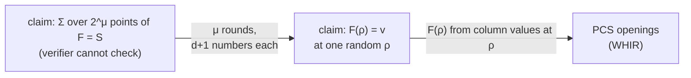
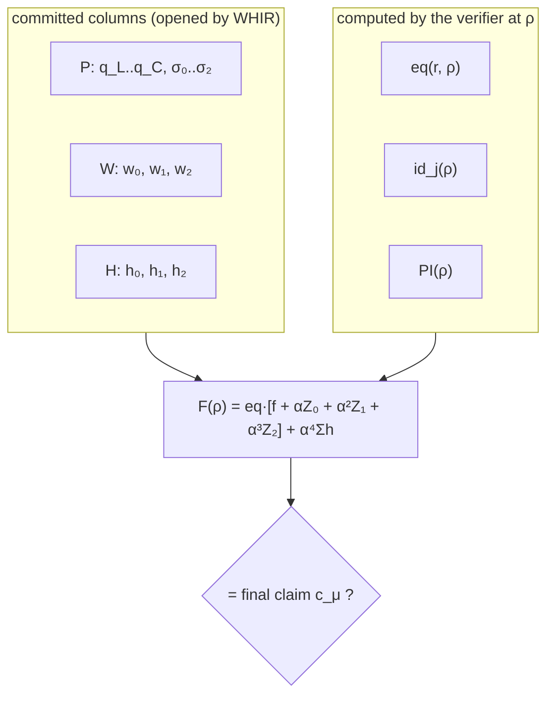

# The sumcheck protocol: checking every constraint with one random evaluation

*A companion to [`OVERVIEW.md`](OVERVIEW.md) §3.2 and §5.4: what the sumcheck protocol is, why it is sound, how the prover runs it in linear time, and how `backend/hyperplonk` uses one sumcheck to check every gate and every copy constraint of a circuit.*

Written 2026-11-06. Status: design document, nothing implemented yet. The normative text is [`SPEC-PIOP.md`](SPEC-PIOP.md) §2.3, §3 and §7; this document explains it and never overrides it.

**Audience.** A master student who knows finite fields, polynomials and basic probability. OVERVIEW §3.1 (multilinear extensions and folding) is useful background but is summarised in §2 below. No prior knowledge of interactive proofs is assumed.

**How to use the toy examples.** All numbers are in F₉₇ and are recomputed by [`toy/sumcheck_examples.py`](toy/sumcheck_examples.py) (`python3 -I docs/hyperplonk-whir/toy/sumcheck_examples.py`, standard library only). The section numbers printed by the script are given in brackets, e.g. *[script §1]*. The running circuit is x² + x + 5 = out from OVERVIEW §5.1 and [`LOGUP.md`](LOGUP.md).

> [!NOTE]
> **About the boxes**
>
> As in OVERVIEW, blue **Note** boxes answer "why …?" questions and green **Tip** boxes answer "what happens if …?" questions: what breaks, or what protects us, when an assumption fails or a party cheats. They can be skipped on a first read.

---

## Contents

1. [The problem: a sum the verifier cannot compute](#1-the-problem-a-sum-the-verifier-cannot-compute)
2. [Tools: Schwartz–Zippel, multilinear extensions, folding](#2-tools-schwartzzippel-multilinear-extensions-folding)
3. [The protocol](#3-the-protocol)
4. [A worked example by hand](#4-a-worked-example-by-hand)
5. [Why it is sound](#5-why-it-is-sound)
6. [The prover: linear time](#6-the-prover-linear-time)
7. [The verifier: what it computes and what it needs](#7-the-verifier-what-it-computes-and-what-it-needs)
8. [Encoding the round messages](#8-encoding-the-round-messages)
9. [The zerocheck: from "the sum is S" to "every row is zero"](#9-the-zerocheck-from-the-sum-is-s-to-every-row-is-zero)
10. [One sumcheck for every constraint](#10-one-sumcheck-for-every-constraint)
11. [Fiat–Shamir: removing the interaction](#11-fiatshamir-removing-the-interaction)
12. [Zero knowledge](#12-zero-knowledge)
13. [The other sumcheck: inside WHIR](#13-the-other-sumcheck-inside-whir)
14. [Implementation notes](#14-implementation-notes)
15. [Variants and the wider landscape](#15-variants-and-the-wider-landscape)
16. [Questions to test your understanding](#16-questions-to-test-your-understanding)
17. [References](#17-references)

---

## 1. The problem: a sum the verifier cannot compute

A circuit with n = 2^μ rows is satisfied when every row satisfies its gate equation and the copy constraints hold. In HyperPlonk both conditions are rewritten as **one statement about a sum over the boolean hypercube** B_μ = {0,1}^μ:

  Σ_{x ∈ {0,1}^μ} F(x) = S,

where F is a polynomial built from the circuit's columns and S is a known value (0 in our case; ρ_g·G in zero-knowledge mode, §12). OVERVIEW §5.4 gives the exact F. This document explains how the prover convinces a verifier that such a sum is correct.

The verifier cannot simply add up the terms:
- there are 2^μ of them, 65 536 at μ = 16, and a SNARK verifier is supposed to be much faster than the computation;
- each term depends on the witness, which the verifier does not have. It sees only *commitments* to the columns and can ask for a few evaluations at points of its choice.

The **sumcheck protocol** (Lund, Fortnow, Karloff, Nisan, 1992) solves both problems. After μ short rounds of interaction it reduces the claim "Σ F = S" to a claim "F(ρ) = v" about **one** evaluation of F at a **random** point ρ ∈ F^μ. That single evaluation is what a polynomial commitment scheme (WHIR, in our system) can deliver.



> [!NOTE]
> **Why is this called a "reduction"?**
>
> Sumcheck does not finish the job on its own: it ends with a claim the verifier still cannot check without help, namely the value of F at ρ. What it achieves is to replace an *exponentially large* claim (2^μ terms) by a *single* evaluation claim, with only a tiny probability that a false claim becomes a true one along the way. Protocols built like this, from a chain of such reductions ending in a commitment opening, are the norm in modern SNARKs; sumcheck is the most important link.

> [!NOTE]
> **Why the hypercube {0,1}^μ and not some other set?**
>
> The protocol works over any product set H^μ, but {0,1}^μ is the simplest: each round deals with just two values of one variable, and a table of 2^μ entries is described exactly by a *multilinear* polynomial (§2). The prover's work then becomes "fold the table in half" each round, which is the source of its linear running time (§6).

---

## 2. Tools: Schwartz–Zippel, multilinear extensions, folding

This section collects the three facts the protocol relies on. If you know OVERVIEW §3.1, skim it.

**Schwartz–Zippel (univariate form).** A non-zero polynomial of degree ≤ d over a field F has at most d roots. So two *different* polynomials of degree ≤ d agree on at most d points, and at a uniformly random r ∈ F they agree with probability ≤ d/|F|. The multivariate form: a non-zero polynomial of total degree ≤ D in μ variables vanishes at a uniformly random point of F^μ with probability ≤ D/|F|.

In bn254's scalar field, |F| ≈ 2^253.6, so even d = 7 gives 7/|F| ≈ 2^-250.8. This is why the algebra of the PIOP is "essentially free" in security terms (OVERVIEW §8.1).

**Multilinear extension (MLE).** Index the n = 2^μ rows of a table T by bit strings b ∈ {0,1}^μ, with X₁ the **most significant** bit (SPEC-PIOP §0). The MLE of T is the unique polynomial of degree ≤ 1 in each variable that agrees with T on the hypercube:

  T̃(X) = Σ_{b ∈ {0,1}^μ} T[b] · eq(b, X),  eq(b, X) = Π_k (b_k X_k + (1 − b_k)(1 − X_k)).

eq(b, ·) is 1 at b and 0 at every other hypercube point.

**Folding.** Because T̃ is linear in X₁,

  T̃(r, X₂, …, X_μ) = (1 − r)·T̃(0, X₂, …) + r·T̃(1, X₂, …).

The tables of T̃(0, ·) and T̃(1, ·) are the first and second halves of T. So fixing X₁ = r is a single pass over the table: new[j] = (1 − r)·T[j] + r·T[n/2 + j]. This is gnark-crypto's `MultiLin.Fold`. Folding μ times evaluates T̃ at any point in O(n) operations. For T = (1, 2, 3, 4), folding at 5 gives (11, 12), and folding that at 7 gives 18 = T̃(5, 7) *[script §1]*.

> [!NOTE]
> **Why is the MLE unique, and why does uniqueness matter?**
>
> A multilinear polynomial in μ variables has exactly 2^μ coefficients, one per subset of the variables, and its 2^μ values on the hypercube determine them (the eq formula is the explicit inverse). So a table and its MLE are the same object written in two bases, and "commit to the table" means "commit to the polynomial". Two different tables have two different MLEs, which agree at a random point only with probability ≤ μ/|F|.

> [!TIP]
> **What happens if one component reads the row index LSB-first?**
>
> It then folds a different variable first: its "X₁" is the other side's "X_μ". For μ = 2 this swaps X₁ and X₂, and the table (3, 1, 4, 1) evaluated at (2, 3) gives 90 one way and 93 the other (OVERVIEW §3.1). If the sumcheck prover folds MSB-first and the PCS evaluates LSB-first, every honest proof is rejected. The convention is fixed once in SPEC-PIOP §0. A unit test of the sumcheck package checks `Fold` against the eq formula on a random point, and the bit-order property test is the first WHIR test to be written (SPEC-WHIR §5, pitfall 3) *[script §5a]*.

---

## 3. The protocol

### 3.1 The statement

Let F(X₁, …, X_μ) be a polynomial over F of degree at most d in **each** variable, and S ∈ F. The prover claims

  Σ_{x ∈ {0,1}^μ} F(x) = S.

The verifier knows S, μ and d, and can obtain the value of F at one point of its choice at the end. In the "PIOP" model this is *oracle access* to F. In practice F is a known formula in a few committed columns, and the oracle is a set of PCS openings.

### 3.2 The rounds

The protocol has μ rounds. Before round 1 the current claim is c₀ = S. In round i (i = 1, …, μ), the variables X₁ … X_{i−1} have already been fixed to the verifier's challenges r₁ … r_{i−1}.

1. **Prover → verifier.** The univariate polynomial

  s_i(t) = Σ_{x_{i+1}, …, x_μ ∈ {0,1}} F(r₁, …, r_{i−1}, t, x_{i+1}, …, x_μ).

  It "keeps X_i free and sums out all later variables". Its degree is ≤ d, so it is described by d + 1 numbers.

2. **Verifier checks** s_i(0) + s_i(1) = c_{i−1} and that s_i has degree ≤ d.

3. **Verifier → prover.** A uniformly random challenge r_i ∈ F. The new claim is c_i = s_i(r_i).

**Final check.** After round μ all variables are fixed, ρ = (r₁, …, r_μ), and the claim is c_μ. The verifier obtains F(ρ) from the oracle and accepts if and only if F(ρ) = c_μ.

**Completeness.** If the prover is honest, s_i(0) + s_i(1) is the sum over x_i ∈ {0,1} of all remaining terms, which is exactly the previous claim; and s_μ(r_μ) = F(ρ). So an honest prover always passes.

```mermaid
sequenceDiagram
    participant P as Prover
    participant V as Verifier
    Note over P,V: claim c₀ = S
    loop round i = 1..μ
        P->>V: s_i(t), degree ≤ d (d+1 numbers)
        Note over V: check s_i(0) + s_i(1) = c_{i−1}
        V->>P: random r_i ∈ F
        Note over P,V: c_i = s_i(r_i); fix X_i = r_i
    end
    Note over V: ρ = (r₁..r_μ); obtain F(ρ) from the oracle (PCS)
    Note over V: accept iff F(ρ) = c_μ
```

> [!NOTE]
> **Why does each round "eat" one variable?**
>
> The claim before round i is about a sum over μ − i + 1 boolean variables (X_i … X_μ), with X₁ … X_{i−1} already fixed. The polynomial s_i splits that sum along X_i: c_{i−1} = s_i(0) + s_i(1). Then the verifier fixes X_i to a random r_i, and the new claim c_i = s_i(r_i) is about a sum over μ − i variables. After μ rounds no sum is left, only one evaluation.

> [!NOTE]
> **Why must the challenge come from the whole field and not from {0,1}?**
>
> If r_i ∈ {0,1}, the new claim s_i(r_i) would be one of the two values the verifier has just added up, and the protocol would reduce to "check half of the sum", once per round — the verifier would end up checking a single hypercube point, i.e. a single row. Drawing r_i from all of F is what makes the final evaluation a *random* point where two different polynomials almost surely differ (§5).

### 3.3 Variables, degrees and sizes in our system

| Symbol | Meaning | Value in hyperplonk v1 |
|---|---|---|
| μ | number of variables = rounds | max(2, ⌈log₂ rows⌉), e.g. 16 for 2^16 rows (≥ 5 in ZK mode, SPEC-PIOP §0) |
| d | degree of F in each variable = degree of each s_i | 4 (ZK mode: 7 in round 1, SPEC-PIOP §4) |
| message size | d field elements per round (§8) | 4 × 32 bytes = 128 bytes |
| total sumcheck data | μ·d elements | 16 × 4 × 32 B ≈ 2 KiB |
| soundness error | ≤ μ·d/\|F\| (§5) | ≈ 2^-247.6 |

---

## 4. A worked example by hand

Take μ = 2 and two tables on rows 00, 01, 10, 11 *[script §1]*:

  A = (1, 2, 3, 4),  B = (2, 0, 1, 3).

The claim is Σ_x Ã(x)·B̃(x) = S. The products are 2, 0, 3, 12, so S = 17. Here F = ÷B̃ has degree 2 in each variable, so d = 2.

**Round 1.** Keep X₁ = t free. Fixing X₁ = t means mixing the two halves: Ã(t, ·) is the table (1 − t)·(1, 2) + t·(3, 4) = (1 + 2t, 2 + 2t), and B̃(t, ·) = (1 − t)·(2, 0) + t·(1, 3) = (2 − t, 3t). Summing over x₂ ∈ {0,1}:

  s₁(t) = (1 + 2t)(2 − t) + (2 + 2t)(3t) = 2 + 9t + 4t².

The prover sends it as three values s₁(0) = 2, s₁(1) = 15, s₁(2) = 36. The verifier checks 2 + 15 = 17 ✓ and sends r₁ = 5. The new claim is s₁(5) = 2 + 45 + 100 = 147 ≡ 50.

**Fold.** Both sides fix X₁ = 5: A becomes (11, 12) and B becomes (2 − 5, 15) ≡ (94, 15).

**Round 2.** s₂(t) = Ã(5, t)·B̃(5, t) = (11 + t)(−3 + 18t). The prover sends s₂(0) = −33 ≡ 64, s₂(1) = 12·15 = 180 ≡ 83, s₂(2) = 13·33 ≡ 41. The verifier checks 64 + 83 = 147 ≡ 50 ✓ and sends r₂ = 7. The new claim is s₂(7) = 18·123 ≡ 18·26 = 468 ≡ 80.

**Final check.** ρ = (5, 7). The verifier asks the oracle for Ã(5, 7) = 18 and B̃(5, 7) = 26, computes 18·26 ≡ 80, which equals the final claim ✓.

<p align="center"></p>

*The animation (figure from OVERVIEW §3.2, numbers from `toy_examples.py`) runs the simplest case, F = T̃ for a single table with μ = 3: each round sends the sums of the two halves and folds at the challenge.*

> [!TIP]
> **What happens if the prover folds the product table A·B instead of A and B separately?**
>
> It computes the wrong polynomial. The MLE of the product table is *multilinear*, but the product of two MLEs has degree 2 in each variable, and the two disagree off the hypercube. In the toy, the table A·B = (2, 0, 3, 12) has MLE 87 at (5, 7), while Ã(5,7)·B̃(5,7) = 80 *[script §2]*. A prover that folds A·B is an honest prover for the wrong polynomial (A·B)~: its messages pass every round check, and only the final check catches it, 87 ≠ 80 *[script §2]*. This is the most common first bug in a sumcheck prover: **fold the columns, never the composed values**. The composition F is applied to the folded columns at every step.

> [!NOTE]
> **Why does the verifier need Ã(ρ) and B̃(ρ), and not (A·B)~(ρ)?**
>
> Because the sum was over ÷B̃, and the protocol ends at the polynomial being summed: F(ρ) = Ã(ρ)·B̃(ρ). That is good news: the verifier needs evaluations of the *committed columns* A and B, which a multilinear PCS can open, and then combines them itself. Nobody ever has to commit to the product.

---

## 5. Why it is sound

### 5.1 One round

Suppose the claim c_{i−1} is false, i.e. it is not the true value of the remaining sum. Let s_i be the *true* round polynomial. Then s_i(0) + s_i(1) ≠ c_{i−1}, so a prover who wants to pass the check must send some s′_i ≠ s_i. Both have degree ≤ d, so by Schwartz–Zippel they agree on at most d points. The verifier's r_i is uniform and chosen *after* s′_i is sent, so

  Pr[ s′_i(r_i) = s_i(r_i) ] ≤ d/|F|.

If they disagree at r_i, the new claim c_i = s′_i(r_i) is again false: the lie has been pushed into the next round. In the last round, a false claim c_μ is compared with the true F(ρ) from the oracle and rejected.

### 5.2 The whole protocol

The cheater escapes only if, in some round, r_i lands on one of the ≤ d agreement points. By the union bound,

  Pr[ verifier accepts a false claim ] ≤ μ·d/|F|.

At μ = 16, d = 4 and |F| ≈ 2^253.6 that is 64/|F| ≈ 2^-247.6.

> [!NOTE]
> **Why do the round errors add up rather than multiply?**
>
> The cheater needs only *one* lucky round. Once r_i hits an agreement point, the new claim is true, and from then on the cheater can follow the honest prover and pass every remaining check. So each round is a separate escape route and the probabilities add. More rounds means slightly *more* risk. The bound is still tiny because each term is d/|F|.

> [!NOTE]
> **Why is the bound "degree in each variable" and not total degree?**
>
> Each round reasons about a *univariate* polynomial s_i, whose degree is the degree of F in X_i. F can have a much larger total degree (÷B̃ has total degree 4 for μ = 2) without hurting soundness. This matters for HyperPlonk: our F has degree 4 in each variable but total degree up to 4μ (eq, q_M, w₀ and w₁ are each multilinear in all μ variables).

### 5.3 Checking the bound exhaustively

In F₉₇ we can try every possible cheat on the example of §4 *[script §3]*. The cheater claims S′ = 18 instead of 17. In round 1 it must send s′₁ = s₁ + e with e(0) + e(1) = 1 and deg e ≤ 2.
- Searching all 97² such error polynomials, the best ones have exactly 2 = d roots, for example e(t) = −t(t − 2). The cheater survives round 1 only if r₁ ∈ {0, 2}.
- If it is not lucky, it plays the same trick again in round 2, with a new error that has the same two roots.
- Over all 97² = 9 409 challenge pairs (r₁, r₂), it wins in 384 cases: 2·97 where r₁ is lucky, plus 95·2 where r₂ is. The rate is 0.0408, just under the bound μd/|F| = 4/97 ≈ 0.0412.

The bound is essentially tight: a cheater can come very close to it, but not beat it.

### 5.4 What the proof relies on

> [!TIP]
> **What happens if the verifier's challenges are predictable?**
>
> Then the protocol is broken completely. In the toy, a cheater who knows r₁ = 5 in advance and wants to claim S′ = 18 sends the *line* s′₁(t) = 26 + 63t. It satisfies s′₁(0) + s′₁(1) = 18 and passes through the true value s′₁(5) = 50 = s₁(5) *[script §4]*. After round 1 the claim is true again, the cheater plays honestly, and the final check passes with probability 1. Every soundness argument in this document assumes that r_i is unpredictable at the moment s_i is fixed. In the non-interactive protocol this becomes the requirement that each challenge is a hash of *everything sent so far* (§11).

> [!TIP]
> **What happens if the verifier accepts a round polynomial of higher degree than d?**
>
> The Schwartz–Zippel argument then uses the larger degree. A cheater sending a degree-D polynomial can make it agree with the true s_i on D points, so it survives with probability D/|F|. With D unbounded it can interpolate the true s_i almost everywhere and survive with probability close to 1. The degree bound is enforced by the *message format*: the verifier reads exactly d_i field elements in round i, a length taken from the protocol parameters (`degrees []int` in the `Verify` signature, SPEC-PIOP §7), never from the proof.

> [!TIP]
> **What happens if the final value F(ρ) is supplied by the prover without an opening?**
>
> Then the final check checks nothing: the cheater simply reports F(ρ) = c_μ. Sumcheck is sound only if F(ρ) is *bound to the committed columns*. In hyperplonk the prover does send the 14 column values at ρ, but they are then proven correct by the three WHIR openings (OVERVIEW §5.4–5.5). A missing or skipped opening turns the whole proof into a formality; the attack test "lie at ρ for each committed column" exists for that reason (SPEC-PIOP §5).

---

## 6. The prover: linear time

### 6.1 Bookkeeping tables

The definition of s_i sums over 2^{μ−i} points, each of which is an evaluation of F at a point with some coordinates fixed to earlier challenges. Done naively this is far too slow. The standard algorithm (Thaler 2013; also in Thaler's book, §4) keeps one **bookkeeping table** per column, folded once per round.

Write F(X) = C(T₁(X), …, T_k(X)), where T₁ … T_k are multilinear columns and C is a fixed polynomial of degree d (the *composition*; `Composition.Eval` in SPEC-PIOP §7). In §4, k = 2 and C(a, b) = a·b.

At the start of round i, each column table has 2^{μ−i+1} entries: the original table already folded at r₁ … r_{i−1}. Let h = 2^{μ−i}. For row j < h of the remaining half-cube, the column's value along X_i = t is the line

  T_ℓ(t; j) = (1 − t)·T_ℓ[j] + t·T_ℓ[h + j] = T_ℓ[j] + t·(T_ℓ[h + j] − T_ℓ[j]).

So the prover computes

  s_i(t) = Σ_{j < h} C( T₁(t; j), …, T_k(t; j) )  for t = 0, 2, 3, …, d,

and after receiving r_i it folds every column at r_i, halving each table.

```text
SumcheckProve(columns T_1..T_k, composition C of degree d, claim):
    for i = 1..μ:
        h = len(T_1) / 2
        for t in {0, 2, 3, .., d}:
            s[t] = Σ_{j<h} C( T_1[j] + t·(T_1[h+j] − T_1[j]), ..., T_k[j] + t·(...) )
        send s[0], s[2..d]                  # s[1] = claim − s[0] is implied
        r_i = challenge()
        claim = interpolate(s[0], claim − s[0], s[2..d]) at r_i
        for each ℓ: T_ℓ = Fold(T_ℓ, r_i)     # T_ℓ[j] = T_ℓ[j] + r_i·(T_ℓ[h+j] − T_ℓ[j])
    return ρ = (r_1..r_μ), final values T_1[0], .., T_k[0]
```

### 6.2 Cost

Round i touches 2^{μ−i} rows, so the total number of rows processed is n/2 + n/4 + … < n. Per row the prover:
- computes each column's line at t = 2, 3, …, d by repeatedly *adding* the difference T[h + j] − T[j] (no multiplication);
- evaluates C at d points (t = 0, 2, …, d), each costing a handful of multiplications;
- folds each column at r_i: one multiplication per column.

So the total is O(n·(k + d·cost(C))) field operations: **linear in the circuit size**. No FFT is ever needed. SPEC-PIOP §6 estimates about 10 million multiplications for our degree-4 composition at n = 2^16 (*estimate*).

> [!NOTE]
> **Why is linear time such a big deal?**
>
> PLONK-style provers spend most of their time on FFTs over domains 4–16 times the circuit size, costing O(n log n) with a large constant. A linear-time PIOP leaves the commitment scheme as the dominant cost. With WHIR that is Reed–Solomon encoding and hashing, which still uses FFTs, but only on the committed tables (OVERVIEW §6). HyperPlonk's title promises exactly this: "Plonk with linear-time prover".

> [!TIP]
> **What happens if the composition is not applied to each row separately?**
>
> The algorithm relies on F being a *pointwise* function of the columns: row j of F depends only on row j of each column. That is why copy constraints, which relate row i to row σ(i), cannot be written directly as a sumcheck and need the LogUp trick (LOGUP.md §1). A composition that mixes rows would need a different protocol, for example a second sumcheck over a "wiring" polynomial, as in GKR.

### 6.3 The eq column

In the zerocheck (§9) one column is eq(r, x), the indicator-like weights at a random point r. The prover builds its table in O(n) by doubling: start with (1), and for each k replace every entry e by the pair (e·(1 − r_k), e·r_k). It is then folded like any other column. A later optimisation (Gruen, ePrint 2024/108) treats the eq factor separately and saves one evaluation point per round; it is postponed until after M2 (SPEC-PIOP §2.3).

---

## 7. The verifier: what it computes and what it needs

Per round the verifier:
1. reads d_i field elements (s_i(0), s_i(2), …, s_i(d_i));
2. derives s_i(1) = c_{i−1} − s_i(0);
3. draws r_i from the transcript (§11);
4. evaluates s_i at r_i by Lagrange interpolation over the points 0, 1, …, d_i: O(d) operations with precomputed weights.

That is O(μ·d) field operations in total, microseconds. After the last round the verifier has ρ and c_μ, and needs F(ρ). In hyperplonk it computes F(ρ) from:
- values it can compute itself in O(μ) or O(ℓ + μ): eq(r, ρ), id_j(ρ), PI(ρ) (§10);
- values supplied by the prover and proven by the PCS: the 14 column evaluations.

> [!NOTE]
> **Why can the verifier compute eq(r, ρ) itself?**
>
> eq(r, ρ) = Π_k (r_k ρ_k + (1 − r_k)(1 − ρ_k)) is a product of μ factors, one per variable. The prover folded a 2^μ-entry table to get the same number; the verifier uses the closed form. In the toy, eq((3, 10), (20, 33)) = 36 both ways *[script §5]*. The same holds for id_j(ρ) = j·n + Σ_k 2^{μ−k}ρ_k, which is linear, and for PI(ρ), which only involves the ℓ public rows (OVERVIEW §5.2).

> [!TIP]
> **What happens if the verifier recomputes F(ρ) with a slightly different formula from the prover?**
>
> For example, with α³ and α⁴ swapped, or with a_j = γ + w_j + β·σ_j instead of β·id_j. All rounds still pass, because they only check internal consistency of the prover's messages. Only the final comparison F(ρ) = c_μ fails, and every honest proof is rejected. This is an annoying bug but a safe one. The dangerous versions are those honest tests cannot see: an omission *shared* by prover and verifier (for example both use one `Composition` that forgets α⁴·Σh, or the spec itself forgets it), or a verifier that skips a check entirely (say, never compares F(ρ) with c_μ). Honest proofs still pass, but a constraint is no longer enforced. That is why SPEC-PIOP §3 gives each verifier check a disable switch: the mutation test turns off each check in turn and requires a cheating proof that only that check rejects.

---

## 8. Encoding the round messages

A polynomial of degree ≤ d is determined by d + 1 numbers. Two encodings are common:

| Encoding | Sent per round | Used by |
|---|---|---|
| evaluations s(0), s(2), …, s(d) | d elements; s(1) = claim − s(0) | hyperplonk PIOP (`sumcheck.Proof{Rounds}`, SPEC-PIOP §7) |
| coefficients c₀, c₂, …, c_d | d elements; c₁ = claim − 2c₀ − c₂ − … − c_d | WHIR's internal sumcheck in the reference code (§13) |

In both cases one element per round is not sent but derived from the claim. In the evaluation encoding, the check s(0) + s(1) = claim then **holds by construction**: there is nothing left to check, and nothing to forget. Soundness is unaffected. The cheater's freedom is the same, a polynomial of degree ≤ d that sums to the claim, and the argument of §5 applies unchanged.

> [!NOTE]
> **Why not send all d + 1 values and check the sum explicitly?**
>
> It costs one element more per round and adds a check that the verifier could forget to make. With the derived value the "check" is built into the parsing. The only thing the verifier must still get right is to use the derived s(1), and not some value from the proof, when interpolating at r_i. With 16 rounds the saving is 16 × 32 bytes, small but free.

**Where a lie shows up.** In the textbook protocol of §3, a false claim fails the round-i check as soon as the prover sends the true s_i. With s(1) derived, as in our encoding, there is no round check: the implied s_i is then a wrong polynomial, and the lie surfaces at the final check, except with probability ≤ μd/|F| (§5). The script prints both views; its "FAIL (textbook round check)" lines refer to the first.

> [!TIP]
> **What happens if the prover and verifier interpolate at different nodes?**
>
> For example, the prover sends s(0), s(2), s(3), s(4) but the verifier treats them as s(0), s(1), s(2), s(3). The two sides then compute different values s_i(r_i) and different claims, and honest proofs are rejected at the final check. The node set {0, 1, …, d} is fixed in the spec, and a unit test checks the interpolation against a direct evaluation of a random polynomial.

---

## 9. The zerocheck: from "the sum is S" to "every row is zero"

The gate check wants something stronger than a sum: the gate polynomial f must be **zero on every row**. A plain sumcheck of Σ f = 0 does not prove that, because positive and negative errors can cancel: f = (1, −1, 0, 0) sums to 0.

**The zerocheck** (HyperPlonk §3.2) draws a random r ∈ F^μ and runs the sumcheck on

  Σ_x eq(r, x)·f(x) = 0.

The left side is exactly f̃(r), the MLE of the table f evaluated at r: the eq weights are the MLE's own weights. If f is non-zero on any row, f̃ is a non-zero multilinear polynomial, and f̃(r) = 0 only with probability ≤ μ/|F|. For f = (1, −1, 0, 0) and r = (3, 10), the weighted sum is 38 ≠ 0 (OVERVIEW §3.2).

The cost: one extra column (eq), and the degree of F rises by one. The gate f has degree 3 (q_M·w₀·w₁), so eq·f has degree 4.

**The zerocheck on the running circuit** *[script §5]*. With the honest witness of OVERVIEW §5.1 every gate value is 0. With r = (3, 10) the eq table is (18, 77, 70, 30); its entries sum to 1, as they always do. The sumcheck of eq·f with claim 0 runs as follows (d = 4, five values per round, four sent):

| round | s(0), s(1), s(2), s(3), s(4) | check | challenge | new claim |
|---|---|---|---|---|
| 1 | 0, 0, 56, 60, 24 | 0 + 0 = 0 ✓ | 20 | 22 |
| 2 | 43, 76, 7, 54, 16 | 43 + 76 ≡ 22 ✓ | 33 | 84 |

From here on r denotes the zerocheck point and the sumcheck challenges are written ρ = (ρ₁, …, ρ_μ), as in SPEC-PIOP. At ρ = (20, 33) the verifier gets the eight column values, computes PI(ρ) and eq(r, ρ) = 36, and checks eq(r, ρ)·f(ρ) = 84 ✓.

Now break one row: set w₂ = 10 instead of 9 in row 1, so row 1's gate value is −1. The weighted sum is 20 ≠ 0. In the textbook protocol, the true round-1 message has s(0) + s(1) = 20 ≠ 0 and fails at once. With s(1) derived, as in our encoding, the implied s₁ is not the true one (s(1) = −20 instead of 0), and the lie surfaces at the final check, except with probability ≤ μd/|F| (§5).

> [!NOTE]
> **Why does eq(r, x) turn "every row" into "one random point"?**
>
> Think of the table f as a vector of n numbers. "f = 0" means all n coordinates are zero. Σ eq(r, x)·f(x) is a random linear combination of the coordinates, with very special weights: they are the values of the n basis polynomials at r. Since a table and its MLE determine each other, the combination is f̃(r), and a non-zero multilinear polynomial is rarely zero at a random point. Any other "random" weights would do for soundness, but the eq weights are the ones a sumcheck can handle, because eq(r, ·) is itself multilinear.

> [!TIP]
> **What happens if r happens to make the bad row invisible?**
>
> eq(r, ⟨01⟩) = (1 − r₁)·r₂ vanishes when r₁ = 1 or r₂ = 0. For such r the broken row has weight 0 and the cheater passes. In F₉₇ there are 193 such points out of 9 409, a rate of 0.0205, just under the bound μ/|F| = 2/97 *[script §5]*. In bn254 the bound is 16/|F| ≈ 2^-249.6. SPEC-PIOP §5 uses the more conservative dμ/|F| for the combined zerocheck.

> [!TIP]
> **What happens if r is drawn before the witness is committed?**
>
> Then the cheater knows which rows have small weight and can hide errors there, or, more powerfully, choose errors on several rows that cancel in the weighted sum: one row with error e and another with error −e·eq(r, x₁)/eq(r, x₂). r must be drawn after root(W) and root(H) are absorbed (SPEC-PIOP §3, step 5), so the errors are fixed before the weights are known.

---

## 10. One sumcheck for every constraint

### 10.1 The polynomial

HyperPlonk must prove four row-wise identities and one global sum (OVERVIEW §5.2–5.3; LOGUP.md §9):
- the gate f(x) = 0 on every row;
- the three LogUp row identities Z_j(x) = h_j·a_j·b_j − (b_j − a_j) = 0 on every row, where a_j = γ + w_j + β·id_j and b_j = γ + w_j + β·σ_j;
- the LogUp total Σ_x (h₀ + h₁ + h₂)(x) = 0.

Instead of five sumchecks, the verifier sends one α and one r, and a **single** sumcheck proves (SPEC-PIOP §2.3)

  Σ_x  eq(r, x)·[ f(x) + α Z₀(x) + α² Z₁(x) + α³ Z₂(x) ] + α⁴ (h₀ + h₁ + h₂)(x) = 0.

The columns are q_L, q_R, q_O, q_M, q_C, σ₀, σ₁, σ₂ (committed at setup), w₀, w₁, w₂ (committed first), h₀, h₁, h₂ (committed after β, γ), plus columns the verifier can compute: id₀, id₁, id₂, PI and eq(r, ·). The degree in each variable is 4: eq·q_M·w₀·w₁ and eq·h_j·a_j·b_j are products of four multilinear factors.

> [!NOTE]
> **Why does one sumcheck suffice for five checks?**
>
> Linearity. The sum of the batched expression is Σ eq·f + α Σ eq·Z₀ + α² Σ eq·Z₁ + α³ Σ eq·Z₂ + α⁴ Σ(h₀+h₁+h₂): a polynomial of degree 4 in α whose coefficients are the five individual sums. If any of them is non-zero, the polynomial is non-zero and vanishes at the random α with probability ≤ 4/|F|. In proof size and verifier work, one sumcheck then costs as much as the most expensive of the five, not their sum: the messages have d + 1 values whatever the number of terms, and the columns are shared. The prover still evaluates every term on every row.

> [!NOTE]
> **Why is the LogUp total outside the eq factor?**
>
> Because it is a genuine *sum* check, not a zero check. The h_j are not zero row by row: only their total is. Multiplying by eq(r, x) would turn the term into h̃(r) = 0, which is false for an honest prover. Mixing the two kinds is fine: the sumcheck does not care what the summand means, only that it has degree ≤ 4 in each variable.

### 10.2 The running example end to end

*[script §6]* With the honest witness, β = 11, γ = 5 (as in LOGUP.md §10), α = 2, r = (3, 10) and challenges ρ = (20, 33):

| round | s(0), s(1), s(2), s(3), s(4) | check | ρ_i | new claim |
|---|---|---|---|---|
| 1 | 90, 7, 71, 29, 72 | 90 + 7 ≡ 0 ✓ | 20 | 45 |
| 2 | 14, 31, 27, 48, 84 | 14 + 31 = 45 ✓ | 33 | 8 |

At ρ the prover reports the 14 committed evaluations

  q = (91, 58, 6, 52, 2), σ = (40, 59, 15), w = (42, 4, 85), h = (42, 66, 24).

The verifier computes the rest itself: id_j(ρ) = 4j + 2·20 + 33 = (73, 77, 81), PI(ρ) = 17·(1 − 20)(1 − 33) ≡ 54, eq(r, ρ) = 36. It rebuilds f, a_j, b_j, Z_j and the full expression, gets 8, and compares it with the final claim 8 ✓.

The copy-breaking cheater of OVERVIEW §5.3 satisfies every gate and every row identity, but its h's sum to 44. The batched sum is then α⁴·44 = 16·44 ≡ 25 ≠ 0. The claim 0 is false, and the sumcheck catches it as in §5 *[script §6]*.



> [!TIP]
> **What happens if the prover lies about one of the 14 evaluations?**
>
> The final check might pass: with one free value the prover can solve for the lie that makes F(ρ) equal its final claim. But the lie then sits inside a claim that WHIR must open, for example y_W = Σ_j eq(τ_W, ⟨j⟩)·w_j(ρ), and WHIR rejects a false opening except with probability ≈ 2^-130 (OVERVIEW §5.4, §5.5). Sumcheck and PCS are designed together: the sumcheck reduces everything to evaluations at one point ρ, and stacking makes that point cost only three openings.

> [!NOTE]
> **Why does it matter that everything ends at the same point ρ?**
>
> All columns are folded with the same challenges, so all of them are needed at the same ρ. That makes stacking work: four columns at the same point become one evaluation of a stack of μ + 2 variables (OVERVIEW §5.5). The paper's product-check permutation argument needs openings at several *different* points, which is one reason this project uses LogUp instead (OVERVIEW §5.3).

---

## 11. Fiat–Shamir: removing the interaction

A SNARK proof is a single message, so the verifier's random challenges are replaced by hashes of the transcript (Fiat–Shamir). For the sumcheck (SPEC-PIOP §3, step 6, and §7):

  ρ_i = ChallengeField("sc/chal", i) after Absorb("sc/round/<i>", s_i(0), s_i(2..d_i)).

Each absorb mixes the message into a running SHA-256 state, and each challenge is derived from that state. So ρ_i depends on every message sent so far, in particular on s_i. *[script §7]* shows the mechanics in the toy field. It is a toy: it binds S as a caller would, reduces modulo 97 and has no length prefixes, so it is not the FS-GRAMMAR of SPEC-PIOP §3.

> [!NOTE]
> **Why is Fiat–Shamir safe for sumcheck, given the "weak Fiat–Shamir" attacks?**
>
> Fiat–Shamir is safe for protocols that are *round-by-round sound*: from any false claim, each single round turns it true only with small probability. Sumcheck is the textbook example, with per-round error d/|F|. A cheater making Q hash queries can try Q different messages for a round, re-hashing each time, and wins with probability about Q·d/|F|: for Q = 2^128 and d = 4, ≈ 2^-123.6. Contrast a protocol with error 1/2 per round repeated 128 times, which Fiat–Shamir breaks with about 256 hashes (OVERVIEW §2.2).

> [!TIP]
> **What happens if the claim S is not bound into the transcript?**
>
> Then a cheater can run the protocol first and choose the claim afterwards, which is the weak Fiat–Shamir attack of Dao et al. In our encoding only s₁(0) and s₁(2..d) are absorbed; s₁(1) is derived from the claim. So the cheater fixes those values, obtains ρ₁, and then solves one linear equation for s₁(1), equivalently for S, so that s₁(ρ₁) equals the true value. From round 2 on it plays honestly. In the toy, s₁(0) = 3, s₁(2) = 4 and ρ₁ = 10 give S′ = 15 ≠ 17, and the proof is accepted *[script §7]*. The sumcheck package does *not* absorb the claim (SPEC-PIOP §7: "the caller binds it"). In hyperplonk the claim is the constant 0, fixed by the protocol, or in ZK mode ρ_g·G, where G is absorbed with root(W) and ρ_g is a challenge. Any future caller of the package must bind its own claim before calling `Prove`.

> [!NOTE]
> **Why does every round have its own label?**
>
> So that no two absorbs can be confused; the absorb label `sc/round/<i>` carries the round index. Unambiguous parsing comes from the length-prefixed grammar of SPEC-PIOP §3 (see the OVERVIEW §5.6 tip on length prefixes).

> [!TIP]
> **What happens if the challenge is reduced from 256 hash bits instead of 512?**
>
> 2^256 ≈ 5.3·p, so reducing a 256-bit value modulo p makes some residues one-fifth more likely than others: about a 4 % statistical bias. For sumcheck the cheater's lucky set has only d elements, so the bias barely helps, but it is a needless loss and it complicates the proof. SPEC-PIOP §3 reduces 512 bits, leaving a bias of about 2^-258. gnark's existing GKR sumcheck reduces 256 bits with `SetBytes(h.Sum(nil))`; SPEC-PIOP §8 explicitly says not to copy that.

---

## 12. Zero knowledge

### 12.1 What the messages leak

Each round message is a sum of witness-dependent values with public weights. For a single table F = T̃, the round-1 message s₁(0) is the sum of the first half of the table. If the table is (secret, 10, 20, 30), then s₁(0) = secret + 10 and the secret is revealed immediately *[script §8]*. Real circuits leak less directly, but μ messages of d values each are μ·d public equations in the witness (linear only in this single-table example), and the final evaluations add more. A ZK sumcheck must hide all of them.

### 12.2 Witness masks raise the round-1 degree

hyperplonk first masks every witness column (OVERVIEW §7.2): w*_j = w_j + c_j·X₁(1 − X₁) with a random c_j. The mask is zero on the hypercube, so the sum, every gate and every copy constraint are unchanged. But it is quadratic in X₁, so in round 1 every masked column contributes a degree-2 factor in t.

In the toy, masking A and B with c = 40 and 23 keeps s₁(0) + s₁(1) = 17, but the round polynomial now has degree 4 instead of 2: s₁(2), s₁(3) change from 36, 65 to 8, 41 *[script §8]*. In hyperplonk the worst term is eq·h*_j·a*_j·b*_j: 1 + 2 + 2 + 2 = 7. Round 1 therefore has degree 7, and later rounds stay at degree 4, because after round 1 the masks have collapsed into the constant c_j·ρ₁(1 − ρ₁).

> [!NOTE]
> **Why only round 1?**
>
> The mask X₁(1 − X₁) depends only on X₁, the first variable the sumcheck binds. After X₁ = ρ₁, the mask term is c_j·ρ₁(1 − ρ₁), a constant added to every entry of the folded table. So from round 2 on the prover works with ordinary multilinear tables. This is why SPEC-PIOP §7 has a `Round1Hook` with an `Offset(col, t)` method: in round 1, c_col·t(1 − t) is added to each column's line *before* the composition is applied, and after fold 1 the sumcheck package itself adds `Offset(col, ρ₁)` to the folded table.

> [!TIP]
> **What happens if the mask is added after evaluating the composition?**
>
> The result is wrong, because the masks enter non-linearly: q_M·w*₀·w*₁ contains the cross term c₀c₁·t²(1 − t)². A prover that computes the unmasked composition and adds "the mask contribution" afterwards misses such cross terms and sends wrong round-1 messages. SPEC-PIOP §4 requires a test that compares the hooked prover with brute-force evaluation of the masked polynomial on a μ = 3 instance.

### 12.3 The Libra mask hides the round messages

The witness masks hide the final values w*_j(ρ), but every round message is still a function of the real witness. This includes s₁(0) and s₁(1), which the masks do not touch because t(1 − t) vanishes at t ∈ {0, 1}: in the toy, s₁(0) = 2 with and without masks, and the leak of §12.1 is untouched. The **Libra mask** (Xie et al., CRYPTO 2019; HyperPlonk App. A.3) fixes this:
1. The prover picks a random g(x) = g₀ + g₁(x₁) + … + g_μ(x_μ), a sum of univariate polynomials of the same degrees as the rounds (7 for g₁, 4 for the others), with g_i(0) = 0.
2. It commits g's coefficients (in the spare slot of W) and sends G = Σ_x g(x).
3. The verifier sends ρ_g, and the sumcheck runs on F + ρ_g·g with claim 0 + ρ_g·G.

Because g is a sum of univariates, its contribution to round i has a closed form: s_i(t) gets

  ρ_g·[ 2^{μ−i}·(g₀ + Σ_{k<i} g_k(ρ_k) + g_i(t)) + 2^{μ−i−1}·Σ_{k>i} g_k(1) ],

the hypercube sum over the later variables, each of which contributes g_k(1) on half of the points (g_k(0) = 0). The fresh coefficients of g_i re-randomise round i's message. At the end the verifier needs g(ρ) = g₀ + Σ_i g_i(ρ_i), which is opened from W.

*Toy [script §8].* With g = 7 + (3x₁ + 5x₁²) + (11x₂ + 2x₂²), G = 4·7 + 2·8 + 2·13 ≡ 70, and ρ_g = 3, the claim becomes 17 + 3·70 ≡ 33. Round 1 sends (83, 79) instead of the unmasked (2, 36), round 2 continues consistently, and the final check passes.

> [!TIP]
> **What happens if ρ_g = 0?**
>
> Then F + 0·g = F, every message is again the unmasked one, and zero knowledge is lost for that proof. Soundness is unaffected. Because the check is cheap, the schedule resamples ρ_g with an incremented counter if it is 0 (SPEC-PIOP §3, step 5). The case ρ₁ ∈ {0, 1}, where the witness masks vanish at ρ, is *not* resampled: soundness is unaffected, it only voids zero knowledge of one proof, and it happens with probability 2/|F| (accepted in review F15, SPEC-PIOP §3 step 6).

> [!NOTE]
> **Why is it safe to reveal G and g(ρ)?**
>
> G is one linear equation in g's coefficients, and g(ρ) is another; Libra's lemma (HyperPlonk Lemma A.2) shows that the round messages remain uniformly random subject to the relations the verifier checks. The simulator can therefore produce messages with the same distribution without the witness. The full inventory of revealed values and the lemma that covers each is in SPEC-PIOP §4.

---

## 13. The other sumcheck: inside WHIR

WHIR, the commitment scheme, runs its own sumcheck in every round (OVERVIEW §6.3). Its statement is

  Σ_b v[b]·w[b] = σ,

where v is the committed message and w a public "linear form": for an evaluation claim y = ṽ(z), w = eq(z, ·). With several claims, w is a random combination of forms. The composition is a product of two multilinear tables, so the degree is 2, exactly the shape of §4. Each WHIR round runs k = 4 sumcheck rounds, folding four variables of v and w with fresh challenges, and then commits the folded message under a new code.

Differences from the PIOP sumcheck:
- Its messages are encoded as coefficients (c₀, c₂), with c₁ derived, as in the reference implementation. v1 keeps both encodings and unifies them later (PLAN M4).
- Its rounds are interleaved with Merkle commitments and queries, so it is not a stand-alone μ-round protocol.
- In ZK mode it is masked by a different technique (ZK-WHIR, ePrint 2026/391, Construction 6.3), with mask polynomials committed in a separate small tree.

> [!NOTE]
> **Why does an evaluation claim become a sum?**
>
> Because the MLE *is* a sum: ṽ(z) = Σ_b v[b]·eq(z, b). Proving "the committed polynomial evaluates to y at z" is therefore a sumcheck of a product of two tables, one secret (v) and one public (eq(z, ·)). At the end the verifier needs v's MLE at the sumcheck point, which WHIR obtains from the next codeword, and w's MLE there, which it computes itself in O(μ). Seen this way, the entire proof system is sumchecks all the way down, glued together by Merkle commitments.

---

## 14. Implementation notes

The package `internal/sumcheck/bn254` is written new (OVERVIEW §10.1). Its interface is fixed in SPEC-PIOP §7:

```go
type Composition interface {
    Degree(round int) int                  // 4, or 7 in ZK round 1
    Eval(cols []fr.Element) fr.Element     // C applied to one row of column values
}
func Prove(t *fs.Transcript, claim fr.Element, cols []polynomial.MultiLin,
           c Composition, h Round1Hook) (proof Proof, rho []fr.Element, finalEvals []fr.Element)
func Verify(t *fs.Transcript, claim fr.Element, degrees []int, p Proof) (rho []fr.Element, finalClaim fr.Element, err error)
```

`Verify` does not check the final value: it returns ρ and the final claim, and the caller (the hyperplonk verifier) computes F(ρ) and compares. That keeps the package generic.

Points that are easy to get wrong:
- **Fold the columns, not the composition** (§4 tip). `Prove` folds the `cols` tables and calls `Eval` on the folded rows.
- **Bit order.** `MultiLin.Fold` binds X₁, the most significant bit, first: it mixes the bottom half with the top half. The eq table, the id columns and the PCS must use the same order (SPEC-PIOP §0).
- **Degree from the parameters.** The verifier reads `degrees[i]` elements in round i, from `Degree(round)`, never a length from the proof.
- **Interpolation nodes** are 0, 1, …, d with s(1) derived; precompute the barycentric weights once per degree.
- **The structural template** is `internal/gkr/bn254/sumcheck.go`, but not its challenge reduction (§11).
- **Parallelism.** The sum over j in each round is split across goroutines and the partial sums added; the fold is embarrassingly parallel. Results must be bit-identical to the sequential version, which is a test.

Tests that matter:
- honest proofs for random tables and random compositions of degrees 1–7, against a brute-force sum;
- `Fold` against the eq formula at random points (bit order);
- the ZK round-1 hook against brute force on μ = 3 (§12.2);
- tampering with each element of each round message must be rejected (by the final check, since the round check is implicit);
- a wrong claim must be rejected; a message of length d_i ± 1 must be rejected at parsing.

> [!TIP]
> **What happens if a tampered round message is only caught by the final check — is that a problem?**
>
> No. With the evaluation encoding there is no per-round check to fail, so *every* tampering is caught at the end, when the verifier compares F(ρ) with c_μ. That is fine for soundness (§5 does not need the verifier to reject early), but it means a sumcheck unit test with a dummy final check would accept anything. The package's tests therefore always finish with a real evaluation of F at ρ from the original tables.

---

## 15. Variants and the wider landscape

- **GKR** (Goldwasser, Kalai, Rothblum 2008) runs one sumcheck per layer of a layered arithmetic circuit, each reducing a claim about one layer to a claim about the next. gnark already contains a GKR implementation (`internal/gkr`), and LogUp-GKR (ePrint 2023/1284) uses it to avoid committing to the h columns; that is a v2 option (LOGUP.md §13).
- **Spartan** (Setty 2020) proves R1CS satisfaction with two sumchecks; it is the multilinear analogue of Groth16/Marlin-style systems, while HyperPlonk is the analogue of PLONK.
- **Gruen's optimisation** (ePrint 2024/108) factors eq(r, x) out of the round polynomial, saving one evaluation per round and some prover work; planned after M2.
- **Small fields.** Over 31- or 64-bit fields, d/|F| is far too large, so challenges are drawn from an extension field. Making the prover fast then requires keeping early rounds in the base field ("small-value" techniques and the "univariate skip" of Gruen, ePrint 2024/108 §5). Irrelevant in bn254, where one field element already gives about 250 bits.
- **Batching across instances.** Several sumchecks with the same number of variables can be merged with random coefficients, exactly as §10 merges constraints; ones with different μ can be aligned by padding.

---

## 16. Questions to test your understanding

*Hint: most questions can be explored by editing [`toy/sumcheck_examples.py`](toy/sumcheck_examples.py).*

1. In §4, compute s₂(3) and check that the four points s₂(0..3) lie on a parabola. Why is it unnecessary for the prover to send s₂(3)?
2. Prove completeness: for an honest prover, show that s_i(0) + s_i(1) = s_{i−1}(r_{i−1}) for every i ≥ 2.
3. The cheater of §5.3 uses an error polynomial with two roots. Show that no error polynomial e of degree ≤ 2 with e(0) + e(1) = 1 has three roots in F₉₇. What changes if d = 3?
4. Run the protocol of §4 binding X₂ first, with X₂ = 7 and then X₁ = 5. Show that the final point (5, 7) and the final value 80 are unchanged but the round messages differ. What changes if instead X₂ = 5 and X₁ = 7? What must prover, verifier and PCS agree on?
5. Write down a sumcheck for Σ_x Ã(x)·B̃(x)·C̃(x). What is d? How many field elements does each round send?
6. In §9, the zerocheck catches the broken row for 9 216 of the 9 409 choices of r. Compute the set of bad r by hand from eq(r, ⟨01⟩) = (1 − r₁)r₂ and confirm the count 193.
7. Why is Σ_x eq(r, x) = 1 for every r? Use this to show that for a constant table c the weighted sum Σ_x eq(r, x)·c is c, so the zerocheck rejects unless c = 0.
8. In §10, what is the degree of the batched polynomial in α? Which terms would have to be added if a lookup were introduced, and does the sumcheck degree change?
9. A cheater knows α but not r before committing H. Can it profit? What if it knows r but not α?
10. Explain why the Libra mask g must have degree 7 in x₁ but only 4 in the other variables. What would go wrong with degree 4 in x₁?
11. A colleague proposes absorbing all round messages at once and deriving ρ₁ … ρ_μ from a single hash at the end. Show how a cheater breaks this, using §5.4.
12. Estimate the prover's multiplications for the batched polynomial of §10 at n = 2^16, counting folds and composition evaluations separately. Compare with the 10 M estimate in SPEC-PIOP §6.

---

## 17. References

- C. Lund, L. Fortnow, H. Karloff, N. Nisan, *Algebraic Methods for Interactive Proof Systems*, JACM 1992. The original sumcheck protocol.
- J. Thaler, *Proofs, Arguments, and Zero-Knowledge*, 2022 (online, free). Chapter 4: sumcheck, its linear-time prover and GKR. The best textbook treatment; not in `resources/`.
- J. Thaler, *Time-Optimal Interactive Proofs for Circuit Evaluation*, CRYPTO 2013. The bookkeeping-table prover of §6.
- S. Goldwasser, Y. T. Kalai, G. Rothblum, *Delegating Computation: Interactive Proofs for Muggles*, STOC 2008 (GKR).
- B. Chen, B. Bünz, D. Boneh, Z. Zhang, *HyperPlonk*, ePrint 2022/1355 (`resources/2022-1355.pdf`). §3.1 (sumcheck as a PIOP), §3.2 (zerocheck), §4 (the PIOP), App. A (zero knowledge, Lemmas A.1–A.2).
- T. Xie, J. Zhang, Y. Zhang, C. Papamanthou, D. Song, *Libra*, CRYPTO 2019, ePrint 2019/317 (`resources/2019-317.pdf`). The ZK sumcheck mask of §12.3.
- A. Chiesa, M. Forbes, N. Spooner, *A Zero Knowledge Sumcheck and its Applications*, ePrint 2017/305 (`resources/2017-305.pdf`). Background on ZK sumcheck.
- A. Gruen, *Some Improvements for the PIOP for ZeroCheck*, ePrint 2024/108 (`resources/2024-108.pdf`).
- U. Haböck, *Multivariate lookups based on logarithmic derivatives* (LogUp), ePrint 2022/1530 (`resources/2022-1530.pdf`); S. Papini, U. Haböck, LogUp-GKR, ePrint 2023/1284 (`resources/2023-1284.pdf`).
- G. Arnon, A. Chiesa, G. Fenzi, E. Yogev, *WHIR*, ePrint 2024/1586 (`resources/2024-1586.pdf`). The sumcheck inside each WHIR round (§13).
- Q. Dao, J. Miller, O. Wright, P. Grubbs, *Weak Fiat–Shamir Attacks on Modern Proof Systems*, IEEE S&P 2023, ePrint 2023/691 (`resources/2023-691.pdf`). Why the claim must be bound (§11).
- S. Setty, *Spartan: Efficient and General-Purpose zkSNARKs without Trusted Setup*, CRYPTO 2020, ePrint 2019/550. Not in `resources/`.
- [`SPEC-PIOP.md`](SPEC-PIOP.md) §2.3 (the batched sumcheck), §3 (transcript), §4 (ZK), §7 (package API); [`OVERVIEW.md`](OVERVIEW.md) §3.2, §5.4, §7.2; [`LOGUP.md`](LOGUP.md).
